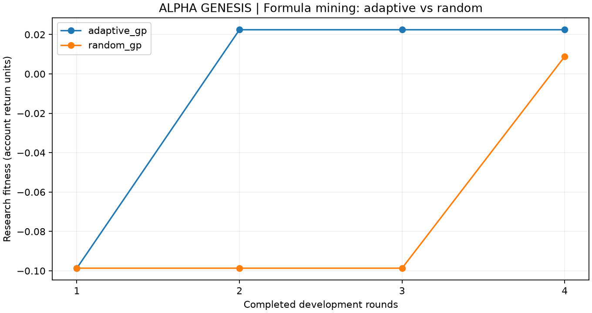

# ALPHA GENESIS · 真实行情自动挖掘实例

本次已在原量化交易系统内完成一次**自动生成公式 → 实测 → 更新搜索策略 → 继续生成 → 封存**的实例，并运行同预算随机对照。没有新建网站。

系统确实完成了自动挖掘；**目前没有候选通过全部开发准入**。本次为遗传公式搜索与反馈驱动的算子选择，在线LLM调用为0，没有进行大语言模型训练，也没有证明完整RSI或稳定超额收益。

## 借鉴了哪些作业

阅读了 [issue #10](https://github.com/aslan9/pku_quantllm/issues/10) 的提交与具体报告，主要借鉴以下机制：

- [Mai-Xu：公式级 Walk-Forward V2](https://github.com/Mai-Xu/Class_6-evolve/blob/main/reports/formula/v2/report.md)：让搜索对象成为公式树，保留公式复杂度限制和同预算随机对照。其报告中随机臂的表现尤其提醒我们，不能只展示一条向上的进化曲线就声称算法更优。
- [Chuboxiao：穿石因子改进](https://github.com/Chuboxiao/stoneflow-quant/blob/main/README_EVOLUTION.md)：把实际父代、失败原因和冻结状态放进原系统模块，明确预测指标改善与净交易有效之间的差别。
- [libichong：Factor Harness](https://github.com/libichong/tradingclass04/blob/main/FACTOR-HARNESS-EXPERIMENT.md)：保留从起始因子到后继候选的完整实测轨迹，同时查看交易成本后的表现。

这些是设计参考。本报告的数字全部来自我们自己的行情计算与账户文件，没有沿用同学的结果。

## 自动挖掘如何工作

初始因子固定为 Alpha#33、Alpha#101、5日价格变化和20日波动率。每轮所有候选先登记，再统一做因果性检查、两个开发窗口的统计评价和真实账户回测。

反馈进化从已完成候选中按开发适应度挑选前三名作为父代来源，自动选择六类变异：居中截面秩之差、秩之积、秩组合、窗口变异、平滑和叶节点替换。交叉来源、实际父代、替换位置与假设写入文件。公式最多15个节点、深度4，不能执行任意Python。

研究选择先比较是否通过全部开发准入，再比较：

```text
fitness = min(各开发窗口的账户净超额)
          − max(0, −min(各开发窗口的账户净收益))
          − 0.0001 × 公式节点数
```

子代优于其实际父代时，对应变异算子获得一次改进记录。系统用上置信界（UCB）平衡已有改进记录与未充分探索的算子，在下一轮继续生成候选。每轮快照记录当时可见的结果，回放早期轮次时不会读取后续轮次的反馈。

随机对照使用相同的公式语法和评价预算，在所有已测父代及变异算子中均匀抽样，**不根据实测得分选父代或算子**。随机对照也记录反馈，便于核查，但反馈不参与其提案选择。

研究选父不等于有效因子入库。最终冻结仍需通过原协议的全部统计与账户门槛，并经过相关性检查；本次没有满足条件的候选。

## 固定实验设置

| 项目 | 本次设置 |
| --- | --- |
| 数据 | 课程真实行情；固定120列，开发矩阵1212日×120列 |
| 股票范围 | 从完整列顺序按等距位置固定取120列，不按本次收益选股 |
| 开发窗口1 | 训练截至2022-12-30，验证截至2023-12-29 |
| 开发窗口2 | 训练截至2023-12-29，验证截至2024-12-31 |
| 搜索预算 | 每臂4轮×4候选＝16；两臂共32候选，其中8次为重复评价的共同初始种子 |
| 账户评价 | 每候选×2窗口×策略/等权基准＝128次账户回测 |
| 资金 | 每个账户100万元 |
| 成交 | 收盘信号、次日开盘；5日调仓；T+1、板块整手、涨跌停/停牌与历史ST约束 |
| 成本 | 佣金万一、滑点5bp、卖出税万五；参与率不超过历史成交额的5% |
| 随机种子 | 20261106 |
| 留出期 | 协议末日2026-09-30；本次未打开历史审核 |

120列属于工程实例，不能代表全市场。字段可用性、退市覆盖、行业/规模暴露和市场冲击仍有局限；已查看过的历史也不称为新盲测。

## 实际结果

| 方法 | 初始最佳适应度 | 第2轮 | 第3轮 | 第4轮 | 子代优于实际父代 | 全部准入通过 |
| --- | ---: | ---: | ---: | ---: | ---: | ---: |
| 反馈公式进化 | −0.098663 | 0.022443 | 0.022443 | 0.022443 | 2/12 | 0/16 |
| 随机公式对照 | −0.098663 | −0.098663 | −0.098663 | 0.008867 | 8/12 | 0/16 |



适应度是上述带惩罚的开发选择目标，**不是收益率或样本外绩效**。随机组优于父代的次数更多，但这些父代也可能更弱；不能把改进次数当作最终收益排名。一组种子的比较不足以证明反馈进化普遍优于随机搜索。

本轮反馈组保留为研究父代的候选是 **#8**：

```text
Mean(Std(ret, 20), 10)
```

也就是20日波动率的10日移动平均。它是第二轮由系统从初始候选#4自动变异得到的，后两轮未发现更高适应度的候选，因此实际保留轨迹为 **#2 → #8 → #8 → #8**。

| 版本 | 2023开发窗口净收益 | 2024开发窗口净收益 | 2023相对等权账户超额 | 2024相对等权账户超额 |
| --- | ---: | ---: | ---: | ---: |
| 父因子#4：20日波动率 | −10.01% | −12.08% | +1.02个百分点 | +8.01个百分点 |
| 子因子#8：20日波动率的10日均值 | −4.38% | −3.83% | +6.65个百分点 | +16.25个百分点 |

**收益改善但仍亏损**。#8同时未通过净标签超额、部分显著性、分层单调性和调仓起点稳定性等统计检查，因此最终仍为“开发拒绝”。2024开发RankIC也从父因子的0.1030降为0.0757，不能声称所有指标都改善。

结构变异同样实际执行了。例如候选#5：

```text
CRank(Alpha#33) − CRank(Alpha#101)
```

其中CRank为当日合格股票内的百分位秩减0.5。它相对实际父代改善了研究适应度，但两个开发窗口的净收益仍分别为−12.56%、−12.09%，没有保留为最终父代，更没有入有效库。其余秩乘积、组合和叶节点替换的失败记录也完整保留。

## 在原系统查看

沿用原来的 `http://127.0.0.1:8501`（远程服务器需使用已有端口转发）：

1. 侧栏进入“因子演化”。
2. 顶部“真实行情 · 自动挖掘实例”中点击“查看反馈进化实例”或“查看同预算随机对照”。
3. 在“演化驾驶舱”回放第1—4轮，查看实际选父、算子反馈、候选公式和失败原因。
4. 在“候选与回测”选择#8及开发窗口，点击“在策略回测中打开此结果”，进入原来的净值、成交、持仓及历史实验展示。

已将#8的第二开发窗口导入原回测历史：`lesson04/runs/factor_2adaf03be189ebb8e6ab`，标记为**开发拒绝、仅供研究**。

## 复现与证据

在仓库根目录运行以下命令，名称必须尚不存在：

```bash
PYTHONDONTWRITEBYTECODE=1 MPLCONFIGDIR=/tmp/quantllm-mpl \
lesson04/.venv/bin/python -m quant_research.experiment \
  --name my_formula_example --scope 120 --rounds 4 --seed 20261106
```

这会重新计算两组完整研究，只运行开发阶段。默认复用课程行情和历史状态资料；可用`--data`、`--status`指定已有数据，`--scope full`使用完整列，所需内存和计算量显著增加。

小型汇总证据已保存，便于脱离大体积缓存阅读：

- [程序生成的原始实例报告](experiments/formula_20261106_v1/REPORT.md)
- [全部候选与两个开发窗口CSV](experiments/formula_20261106_v1/candidates.csv)
- [逐轮搜索轨迹](experiments/formula_20261106_v1/history.csv)
- [机器可读对照结果](experiments/formula_20261106_v1/comparison.json)
- [本次账户与血缘核对结果](experiments/formula_20261106_v1/verification.json)

完整账户、每轮提案、父代与交叉来源、封存清单保留在本机：

```text
research_runs/formula_20261106_v1_adaptive_gp/
research_runs/formula_20261106_v1_random_gp/
research_runs/formula_20261106_v1_comparison/
```

核对了846个封存文件、32个候选、64个开发窗口、128个账户和107,919条成交记录，核对项包含净值到收益率的一致性、成交晚于信号、费用/滑点合计、父代早于子代及相同输入指纹。45项研究测试与27项界面/任务/原系统集成测试通过，真实实例也通过了“原主界面→演化实例→第二轮回放→#8→原策略回测”的操作验证。

算子升级到`causal-price-volume-v3-formula`；旧批次仍按其原始证据浏览，不能用新版代码重开旧审核。
