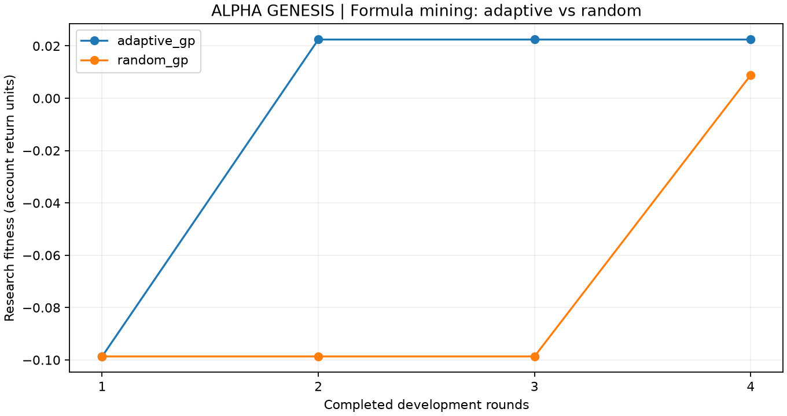

# ALPHA GENESIS · 真实行情公式自动挖掘实例

固定种子、同预算的开发期比较；未打开2025—2026历史审核。

| 方法 | 候选数 | 子代优于实际父代 | 初始最佳适应度 | 最终最佳适应度 | 完整准入通过 |
| --- | ---: | ---: | ---: | ---: | ---: |
| 公式进化 · 反馈选父与算子学习 | 16 | 2 | -0.098663 | 0.022443 | 0 |
| 随机公式对照 · 不使用反馈选父 | 16 | 8 | -0.098663 | 0.008867 | 0 |



## 选定的研究公式

### 公式进化 · 反馈选父与算子学习

候选 #8；`formula_20261106_v1_adaptive_gp`。

```json
{
  "expression": {
    "arg": {
      "op": "volatility",
      "window": 20
    },
    "op": "smooth",
    "window": 10
  },
  "hypothesis": "公式树smooth变异；父候选#4；开发诊断：预测排序未稳定转化为扣费后的组合增益。检验跨开发窗口账户收益是否改善；结果须重新经过全部准入。",
  "name": "gp_r2_4_smooth",
  "parent_id": "f31e0e4004dc265b2acd289bfb9651108906e3658369949b4936295c0d04fc19"
}
```

### 随机公式对照 · 不使用反馈选父

候选 #16；`formula_20261106_v1_random_gp`。

```json
{
  "expression": {
    "op": "volatility",
    "window": 10
  },
  "hypothesis": "公式树window变异；父候选#4；开发诊断：预测排序未稳定转化为扣费后的组合增益。检验跨开发窗口账户收益是否改善；结果须重新经过全部准入。",
  "name": "gp_r4_4_window",
  "parent_id": "f31e0e4004dc265b2acd289bfb9651108906e3658369949b4936295c0d04fc19"
}
```

## 解释边界

- 反馈进化使用有界遗传变异和UCB算子选择；在线LLM调用为0，不涉及模型权重训练。
- 研究适应度为最差开发窗口账户净超额，扣除最差负收益与公式节点惩罚；完整准入优先。
- 一次种子、固定120列（如使用默认范围）的工程实例，不能外推全市场或证明搜索机制更优。
- 已看过的历史不称盲测；未调用历史审核不代表证明了样本外收益。
- 指标改善的拒绝候选仍不能入有效因子库或自动启用交易。
- 全部候选、失败原因、父代和交叉来源见 candidates.csv；每轮反馈及提案在原研究批次 search/ 中封存。
