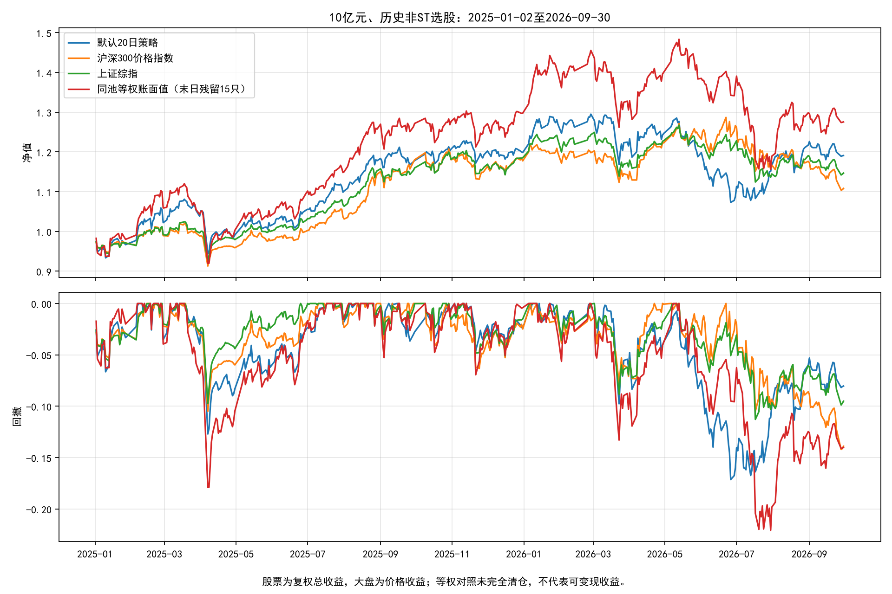

# 非ST全市场选股：10亿元作业回测与独立审计

**能：在给定沪深面板和指定区间的回测中，策略扣费及基础滑点后盈利，并同时跑赢沪深300和上证综指，首日建仓、末日清仓均已完成。**

方案为**20日低市场偏离波动率选股、目标200只等权、每20个交易日调仓**。
2025-01-02开盘开始，2026-09-30开盘清空；初始10亿元，期末现金 **11.9098亿元**，
累计净收益 **19.10%**，相对沪深300高 **8.29个百分点**，
相对上证综指高 **4.42个百分点**。

**但尚不能称为稳健优秀的投资策略：这是第一轮失败后的探索，作业区间已经用于研究；策略回撤大于两项大盘基准，也没有证明优于同池等权选股。不能承诺未来仍跑赢。**

## 1. 老师要求与实际核验

| 要求 | 本次实际 |
| --- | --- |
| 非ST全市场选股 | 对课程沪深5451列计算候选；逐日历史ST筛选，未知状态不买，再施加流动性/有价历史门槛 |
| 初始10亿元 | 1,000,000,000元，无杠杆、无做空 |
| 佣金单边万一 | 买卖实际成交金额各收0.0001 |
| 印花税万五 | 仅卖出实际成交金额收0.0005 |
| 2025年首个交易日建仓 | 2025-01-02买入200只，信号截止2024-12-31 |
| 2026年9月末交易日清仓 | 2026-09-30实际卖完，期末持仓0，全部权益为现金 |
| 额外执行假设 | 基础滑点每边0.0005，前20日平均成交额5%的交易金额上限，正常方向涨跌停、T+1、板块交易数量 |

作业共424个交易日。给定面板只覆盖沪深证券，**没有北交所，也不能证明涵盖全部历史退市股票**。
这里的“全市场”是面板范围内全市场筛选，不是只在沪深300成分股中选股。

## 2. 策略规则和研究依据

令复权收盘价 `P_i(t)=close_i(t)×cumadj_i(t)`，日收益 `r_i(t)=P_i(t)/P_i(t−1)−1`。
每个历史日使用**该日非ST、收益有效**股票的等权平均收益作为市场代理 `r_m(t)`。
计算 `D_i(t)=std(r_i−r_m，最近20个交易日)`，按D从低到高取目标200只，等权。
这是**固定市场系数为1的市场偏离波动率**，没有做OLS回归，不能冒称真正的“特质波动率”。市场代理也是合成近似，并非真实指数。

研究假设是保留市场方向、减少单股偏离噪音。MSCI关于[低波动及常见因子](https://www.msci.com/research-and-insights/blog-post/what-is-factor-investing)
和[低波动与市场周期](https://www.msci.com/research-and-insights/paper/low-volatility-over-the-market-cycle-understanding-factor-investing)提供方向性背景，
**并未证明这里的20日窗口、200只及具体公式最优**。

选股前剔除：当日ST/未知状态、累计有效价格观测不足120日、最近20日收益不完整、
原始收盘/复权因子无效、最近20日成交额不完整或日均成交额低于1亿元，以及截至当日已公告的特定长期停牌/旧代码终止事件。
不截取成交额前N名，不用成交日收盘价、全日成交额或未来ST状态筛选开盘订单。
21次常规选股时，可选池为2445至3868只。

收盘发出目标权重，下一交易日开盘执行；价格、停牌或成交上限造成的差额留在账户中。
**200只是目标数量，未卖完的旧持仓会保留，实际持仓数最高为273只，不能声称始终只持有200只。**

## 3. 研究过程和失败记录

第一轮固定3个候选，用2023—2024年净Sharpe选择总波动率最低的100只策略；该方案在作业区间仅收益4.39%，
低于两个大盘基准，期末还有5只未清仓，已否定并保留[第一轮完整报告](ASSIGNMENT_ROUND1_REPORT.md)、
[全部实验](research/assignment/results/experiments.csv)和[source_snapshot](research/assignment/results/source_snapshot)。

随后才制定[后续探索协议](research/assignment/FOLLOWUP_PROTOCOL.md)，改为市场偏离波动，K=200、ADV门槛1亿元；
`10亿/200=500万元=1亿元×5%`是容量对应关系。默认窗口20日，60日只作事先写下的对照；
**没有把60日或零滑点中收益更高的结果换作主实验，也没有大网格搜索。**
此外补充公告可知后的风险退出，并在最后5个交易日分批减仓，解决单日清仓的容量问题。

后续方案2023—2024年的参考累计收益为21.34%、Sharpe 0.529、最大回撤-32.62%，
训练区间末仍残留4只。**这些历史残留没有被删除；不宣称此策略在所有区间均已验证可清仓。**
本次方案是在已经查看作业窗口之后提出，属于探索样本结果，不能称为独立样本外证明。

## 4. 净值、回撤与真实大盘比较

| 组合/指数 | 累计收益 | 年化收益 | 最大回撤 | Sharpe（无风险利率0） |
| --- | --- | --- | --- | --- |
| 默认20日市场偏离波动选股 | 19.10% | 10.95% | -17.14% | 0.644 |
| 沪深300价格指数 | 10.81% | 6.29% | -14.21% | 0.446 |
| 上证综指 | 14.67% | 8.48% | -11.28% | 0.639 |
| 60日窗口对照 | 16.02% | 9.23% | -16.26% | 0.585 |
| 同池等权（期末仍有残留） | 27.55% | 15.56% | -22.06% | 0.734 |



两个真实指数均使用**首日开盘至末日开盘**，中间以当日收盘估值，不扣指数交易费用。
行情来自腾讯并与BaoStock逐日交叉检查，输入缓存和校验见[data/indices_manifest.json](research/assignment/data/indices_manifest.json)。
若使用末日收盘，沪深300为10.83%、上证综指为14.76%，不偷换退出端点。

**股票复权收益包含分红再投资；上述大盘是价格指数，分红口径不完全一致。**
因此结论限定为跑赢这两个明确的价格基准，没有证明对相同总收益基准存在alpha。
同池等权账面收益27.55%高于选股策略，但期末仍残留15只、
无法按要求全部变现，不能将其账面值当作可实现的清仓收益；也不能因此把它从对照中隐藏。

| 年份 | 默认策略 | 沪深300 | 上证综指 | 同池等权账面值 |
| --- | --- | --- | --- | --- |
| 2025 | 19.85% | 17.76% | 18.55% | 29.76% |
| 2026年1—9月 | -0.63% | -5.90% | -3.27% | -1.70% |

## 5. 首尾建仓和清仓

首笔买入日2025-01-02，首笔信号日2024-12-31，
最后卖出日2026-09-30。
最后5个交易日按剩余退出天数缩减目标权重，最后一天目标为0；仅使用已知交易日历，不使用未来价格。

| 日期 | 持仓证券数 | 现金（亿元） | 总权益（亿元） |
| --- | --- | --- | --- |
| 2026-09-22 | 242 | 0.0012 | 12.2003 |
| 2026-09-23 | 242 | 2.4349 | 12.1007 |
| 2026-09-24 | 242 | 4.8355 | 11.9971 |
| 2026-09-28 | 242 | 7.2139 | 11.8908 |
| 2026-09-29 | 242 | 9.5388 | 11.9022 |
| 2026-09-30 | 0 | 11.9098 | 11.9098 |

所有停牌、限价及容量受阻持仓都保留；没有用最后有效价虚构卖出或直接删除证券。
主实验ST持仓累计0个证券日，状态未知持仓累计0个证券日，
缺价持仓累计0个证券日；末日独立重建账户同样为0持仓、现金1,190,981,929.14元。

## 6. 交易成本、换手和容量

- 佣金3,554,048.40元，卖出印花税8,935,989.00元，合计12,490,037.40元。
- 滑点成本17,770,297.33元，已经反映在成交价，统计时不二次扣款。
- 总费用加滑点占初始10亿元3.03%，不是用利润作分母。
- 年化双向换手18.49倍（日均买卖原始金额/开盘权益×252）。
- 独立核验最大单次成交原始金额/前20日均成交额为5.00%，设定上限5%。
- 涨跌停拒绝1次/共8900次取整前意图尝试，即0.01%；容量部分成交另列，不能只拿涨跌停比例冒充全部不可成交比例。

| 受阻/部分成交原因 | 记录数 |
| --- | --- |
| sell_participation_cap | 557 |
| buy_participation_cap | 479 |
| suspended_or_unknown_trade_status | 12 |
| limit_down_sell | 1 |

5%是基于**历史全日成交额**的计划限制，不能证明开盘集合竞价存在足够对手量；真实10亿元交易可能有更大冲击。
限价使用原始open与供应商未复权preclose近似判断，不使用复权价；300/301/302/688/689按20%，其余普通主板10%。
主板ST在2026-07-06前5%、之后10%，参照[上交所正式生效通知](https://www.sse.com.cn/lawandrules/sselawsrules2025/trade/universal/c/c_20260424_10816492.shtml)
及[深交所配套规则](https://www.szse.cn/lawrules/service/member/t20260630_621404.html)。没有完整特殊交易制度和官方逐日限价，仍属于近似。

## 7. 有限敏感性

| 实验 | 累计收益 | 相对沪深300（百分点） | 相对上证综指（百分点） | 末日残留 |
| --- | --- | --- | --- | --- |
| 20日窗口，单边滑点5基点 | 19.10% | +8.29 | +4.42 | 0 |
| 20日窗口，零滑点 | 20.97% | +10.16 | +6.30 | 0 |
| 20日窗口，单边滑点15基点 | 15.40% | +4.59 | +0.73 | 0 |
| 60日窗口，单边滑点5基点 | 16.02% | +5.21 | +1.35 | 0 |

15基点滑点下虽然仍高于两个大盘基准，但相对上证综指的优势已很小，**执行误差或新增成本可能翻转结论**。
策略回撤比大盘更深，Sharpe与上证综指接近，不能只看累计收益就判断风险调整后明显优越。

## 8. 历史ST和公告数据

BaoStock逐证券历史`isST`、`tradestatus`、`preclose`按日期对齐。查询5451只，0次最终请求失败，38只在2022年初至2026-09-30间返回空历史；
不将空记录解释为非ST。在**作业区间有原始价格的证券**中，逐日ST覆盖率最小值100.00%、平均值100.00%，
每日ST证券127至263只。

001270.SZ的2025-04-24起ST、2026-05-20撤销等状态已对照[实施公告](https://disc.static.szse.cn/download/disc/disk03/finalpage/2025-04-23/1fc0c56b-fbc2-43c1-bd4c-aca59b26b088.PDF)
与[撤销公告](https://disc.static.szse.cn/disc/disk03/finalpage/2026-05-19/7dcd926a-5a98-4b8b-b5cb-185bc679a713.PDF)，
见[data_crosschecks.json](research/assignment/data/data_crosschecks.json)。这是抽样核对，不能保证供应商全量标签零误差；
没有逐条公告精确发布时间，回测假设生效日ST状态在盘前可知。

课程数据的非空open不一定表示可交易。例如601198停牌后仍显示13.06，外部交易状态阻止了假成交。
后续研究使用以下公开公告，在**公告日收盘之后**才排除新买并尝试退出存量；不回溯剔除公告前持仓：

| 证券 | 公告可知日（按该日收盘处理） | 事项 | 来源 |
| --- | --- | --- | --- |
| 600837.SH | 2025-01-22 | 已公告将长期停牌并吸收合并 | [原始公告](https://www.hkexnews.hk/listedco/listconews/sehk/2025/0121/2025012100990_c.pdf) |
| 300114.SZ | 2025-02-12 | 已公告旧证券代码将终止使用 | [原始公告](https://www.cnindex.com.cn/zh_information/notices_news/2025/202502/P020250212310734081331.pdf) |
| 601989.SH | 2025-08-07 | 已公告将长期停牌并吸收合并 | [原始公告](https://static.sse.com.cn/disclosure/listedinfo/announcement/c/new/2025-08-07/601989_20250807_Z8KN.pdf) |
| 601198.SH | 2026-09-08 | 已公告将长期停牌并吸收合并 | [原始公告](https://static.cninfo.com.cn/finalpage/2026-09-08/1225552616.PDF) |
| 601059.SH | 2026-09-08 | 同一吸收合并交易公告已公开 | [原始公告](https://static.cninfo.com.cn/finalpage/2026-09-08/1225552616.PDF) |

这张清单是看到执行问题后补录的有限案例，**并非完整、事先维护的全市场历史公告数据库**；
虽然执行时按历史可知日过滤，也存在研究者事后选择哪些事件入库的偏差。不能把这层人工事件处理包装成已证明全自动有效。

## 9. 默认与实际参数

| 参数 | 默认 | 主实验实际 | 依据 |
| --- | --- | --- | --- |
| initial_cash | 通用引擎100万元 | 10亿元 | 老师给定 |
| commission | 通用引擎0.0003 | 0.0001/边 | 老师给定 |
| sell_tax | 通用引擎历史分段 | 固定0.0005，仅卖出 | 老师给定；训练参考也用相同费率 |
| start/end | 通用引擎无 | 2025-01-02/2026-09-30 | 老师给定、实际交易日 |
| window | 20日 | 20日，60日仅对照 | 研究者选择；不是证明最优 |
| K/holding | 200只/20日 | 200只/20日 | 分散、约月度调仓；失败后探索固定 |
| market_beta_fixed | 1 | 1 | 简单市场偏离假设，无OLS拟合 |
| min_listed | 120 | 120个有效价格观测 | 研究者经验；不是真实IPO日期 |
| min_adv | 1亿元 | 前20日均额≥1亿元且20日均正 | 10亿/200=500万，与1亿×5%对应 |
| max_participation/volume_lookback | 通用引擎无/20 | 5%/20日 | 研究者经验容量限制，不保证开盘量 |
| slippage | 0.0005 | 0.0005/边，另测0和0.0015 | 研究者假设 |
| liquidation_signals | 策略无 | 最后5个交易日前收盘发分批退出信号 | 为满足末日清仓的执行修正，非收益寻优 |
| notices | 策略无 | 上表5项，公告日收盘起生效 | 已核实来源、事后补录，存在清单选择偏差 |
| equal_weight | False | False；True仅作控制 | 默认按偏离波动选股 |
| lot_size/board_lots | 100/False | 100/True | 主板/创业板100份，科创最低200份且1份递增 |
| execution_policy | legacy_reversal | standard | 新任务按正常方向涨停不买、跌停不卖 |
| prestart_signal/liquidate_on_last_day | False/False | True/True | 首日开盘建仓、末日强制目标0 |
| exit_st_on_open/defer_suspended_orders | False/True | True/True | ST生效时尝试退出，缺价顺延，受阻仍保留 |
| annual_days | 252 | 252 | 年化统计惯例 |

## 10. 仍可能使实盘差于回测的因素

1. **幸存者和历史覆盖偏差**：不能证明面板涵盖全部退市证券；发现部分退市代码也不能排除遗漏。没有北交所。
2. **样本内探索**：研究者已接触目标区间，第一轮失败后更换假设、增加执行控制；没有独立未见数据验证，不保证未来盈利。
3. **分红口径**：股票为复权总收益，对照为价格指数；分红优势不能冒称全部来自选股。
4. **复权会计近似**：cumadj比率调整合成份额，代表总收益再投资，不是真实股数、分红到账和税差；全清合成零碎份额不完全对应真实交易。
5. **执行**：缺盘口、开盘量、全部历史特殊涨跌停制度、最小佣金和额外过户费；5%历史成交额上限和固定滑点可能偏乐观。
6. **事件与退市**：公告清单不完整，未通用实现全部代码迁移、并购换股和退市回收；对照及训练仍有残留，主实验只是在本样本核验清仓完成。
7. **风险和风格**：没有行业、市值和指数历史成分数据，不能行业/规模中性化；较高收益可能来自风格暴露，而非稳定alpha。

## 11. 验证与复现

独立脚本不调用引擎，从原始价、历史状态及成交逐笔重新建账，核对ST、交易状态、原始开盘、T+1、费用、限价、历史ADV容量，
并独立重排全市场信号、核对逐日现金/权益和源文件哈希。本轮 **7,966,285项检查通过**，
见[audit.json](research/assignment/followup_results/audit.json)。84项单元/界面测试通过，见[tests.log](research/assignment/tests.log)。

- [策略源码](backtest/market_deviation_strategy.py)、[运行脚本](research/assignment/run_followup.py)、[独立审计](research/assignment/audit.py)。
- [原始逐笔成交](research/assignment/followup_results/selected/trades.csv)、[逐日账户](research/assignment/followup_results/selected/equity.csv)、[持仓](research/assignment/followup_results/selected/positions.csv)、[选股](research/assignment/followup_results/selected/selections.csv)、[执行控制](research/assignment/followup_results/selected/controls.csv)、[受阻订单](research/assignment/followup_results/selected/rejected_orders.csv)。
- [全部实验](research/assignment/followup_results/experiments.csv)、[基准与策略日净值](research/assignment/followup_results/comparison.csv)、[年度表](research/assignment/followup_results/annual.csv)、[数据与源码哈希](research/assignment/followup_results/manifest.json)、[历史状态文件哈希](research/assignment/followup_results/status_file_hashes.csv)。
- [第一轮否定结论](ASSIGNMENT_ROUND1_REPORT.md)完整保留，不用当前方案覆盖失败结果。

```bash
uv sync --locked
# 首次缺历史缓存时下载；不需要账号或密钥。
uv run python -m research.assignment.fetch_data --workers 4
uv run python -m research.assignment.fetch_indices
uv run python -m research.assignment.data_quality
# 必须使用尚不存在的结果目录。
MPLCONFIGDIR=/tmp/quantllm-lesson04-matplotlib uv run python -m research.assignment.run_followup --output research/assignment/reproduction
uv run python -m research.assignment.audit --results research/assignment/reproduction
uv run python -m research.assignment.make_followup_report --results research/assignment/reproduction --report ASSIGNMENT_REPRODUCTION_REPORT.md
```

生成时间：2026-10-23T03:55:59.598246+00:00；行情及ST缓存取自2026-10-16，审计核对其哈希，没有把后来行情混入作业窗口。
