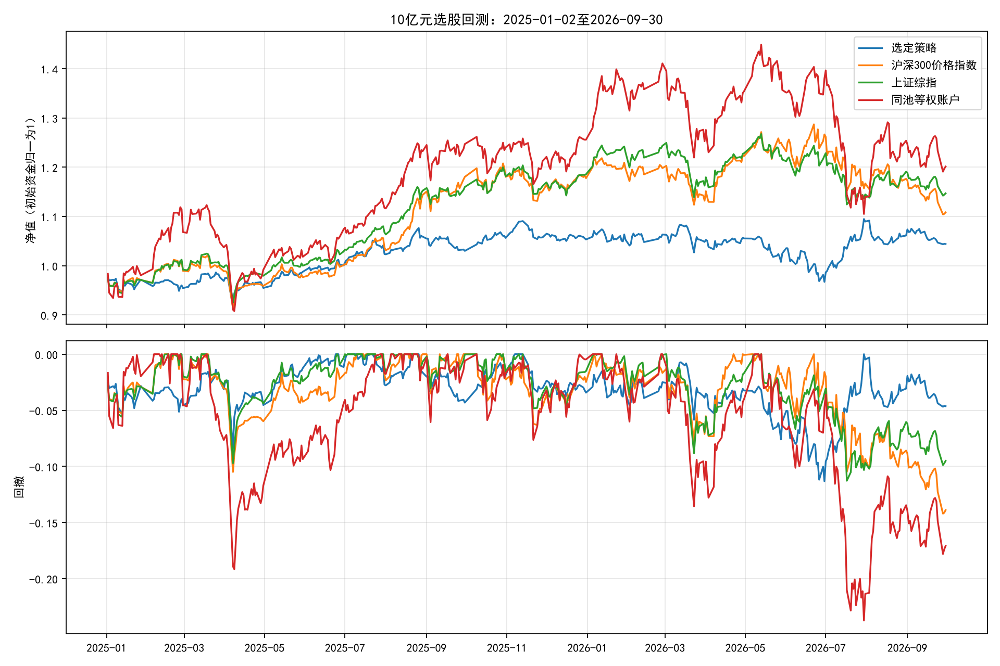

# 全市场选股作业：独立审计回测报告

**策略在这次回测中盈利，但未同时跑赢沪深300和上证综指，不能声称已完成用户要求的策略验证。**

最终方案：**60日低波动等权选股**。初始资金10亿元，期末权益 **10.4394亿元**，累计净收益 **4.39%**。
相对沪深300累计收益高 **-6.42个百分点**，
相对上证综指高 **-10.28个百分点**。
以上只说明这个历史样本的回测结果，不证明未来一定获利或存在稳定选股alpha。

## 1. 作业约束与实际执行

| 老师要求 | 本次实际 |
| --- | --- |
| 非ST全市场选股 | 对课程沪深5451列计算候选信号；按逐日历史ST剔除，未知状态不买，另设上市时间和流动性门槛 |
| 10亿元初始资金 | 1,000,000,000元，无杠杆、无做空 |
| 佣金单边万一 | 买卖实际金额各收0.0001 |
| 印花税万五 | 仅卖出实际金额收0.0005 |
| 2025年第一个交易日建仓 | 2025-01-02开盘，实际首日买入100笔；信号截至2024-12-31 |
| 2026年9月最后交易日清仓 | 2026-09-30开盘尝试清仓；期末残留5只 |
| 执行改进 | 单边基础滑点0.0005，主板/创业板100份、科创最低200份且1份递增，涨停不买/跌停不卖，历史成交额5%的单笔金额上限 |

本地没有北交所数据，**“全市场”仅指给定沪深面板内选股**，不冒称覆盖所有历史A股。区间共424个交易日。

## 2. 为什么研究这个方向、怎样确定方案

MSCI官方研究将低波动和动量列入常见因子，支持作为研究先验，但并不保证本地样本收益。
本轮运行候选账户前写下 [固定研究规则](research/assignment/PROTOCOL.md)，仅比较3个固定候选，
按2023—2024年的扣费Sharpe最高选定方案，之后在作业窗口不再选择胜者或调参数。
训练阶段也统一使用老师的固定费率，并非复刻2023年印花税制度变化。

| 训练候选 | 累计净收益 | 年化净收益 | 最大回撤 | 净Sharpe | 训练末残留 |
| --- | --- | --- | --- | --- | --- |
| 60日低波动等权选股 | 26.53% | 13.03% | -14.85% | 0.903 | 9 |
| 中期动量等权选股 | -30.12% | -17.02% | -56.37% | -0.386 | 1 |
| 低波动与中期动量等权打分选股 | 20.22% | 10.06% | -22.09% | 0.680 | 18 |

选定方案为 `lowvol60`，具体信号：对每只股票计算最近60日复权日收益的样本标准差，从低到高取100只。这里计算总波动率，没有把减去市场平均收益后的波动率冒称为回归残差/特质波动率。

全池先剔除历史ST/未知状态、上市有价观测不足120日、信号日无有效原始收盘/复权因子、
过去60日日收益不完整、过去20日无完整正成交额或平均成交额低于2亿元的证券。
持仓等权，每20个交易日收盘更新目标，下一交易日开盘执行；重合持仓只交易权重差额。
没有借助成交日的收盘价或全日成交额决定开盘选股。ST生效日盘前状态仅用于禁止买入及退出。

**样本使用限制：** 目录里已有 `verify/` 研究事先查看过作业区间。本轮虽以2023—2024年选择候选，
也不能把2025—2026年冒称为完全未接触过的样本外检验。低波动方向也不是本轮首次发现。

## 3. 收益、风险与基准

| 组合/指数 | 累计收益 | 年化收益 | 最大回撤 | Sharpe（无风险利率0） |
| --- | --- | --- | --- | --- |
| 60日低波动等权选股 | 4.39% | 2.59% | -11.32% | 0.269 |
| 沪深300价格指数 | 10.81% | 6.29% | -14.21% | 0.446 |
| 上证综指 | 14.67% | 8.48% | -11.28% | 0.639 |
| 同流动性股票池等权账户 | 20.12% | 11.51% | -23.73% | 0.559 |



真实指数均按**首日开盘买入、末日开盘退出**计算；中间按当日收盘标记。指数不扣交易费。
沪深300/上证综指若用末日收盘退出，收益分别为10.83%和14.76%，不作为挑选有利结论的替代端点。
指数行情来自腾讯，并与BaoStock逐日核对；各指数核对446行，最大价格差0.0050点（显示精度差异）。

**口径限制：股票是含分红再投资的复权总收益模型，上述指数是价格指数，分红口径不完全一致。**
因此“跑赢大盘”仅指跑赢这两个明确列出的价格基准；未据此证明对相同总收益指数有alpha。
辅助等权账户使用相同ST/流动性/收益完整性筛选、调仓日期、费用、滑点和成交上限，其期末残留为17只。
辅助账户如未清仓，其末日是残留持仓市值加现金，不能冒称可变现收益。

| 年份 | 策略 | 沪深300 | 上证综指 | 同池等权 |
| --- | --- | --- | --- | --- |
| 2025 | 5.31% | 17.76% | 18.55% | 25.57% |
| 2026年1—9月 | -0.87% | -5.90% | -3.27% | -4.34% |

## 4. 换手、成本、容量与不可成交

- 年化双向换手：8.18倍（买入加卖出金额/开盘权益，日均乘252）。
- 佣金：1,407,233.68元；印花税：3,527,591.83元；费用合计：4,934,825.51元。
- 滑点成本：7,036,179.66元，已反映在成交价中，不二次扣除。
- 总费用加滑点占初始资金：1.20%；不是用利润作分母。
- 涨跌停拒绝2次，占所有取整前意图尝试0.07%；停牌尝试比例0.00%。
- 逐笔审计得到最大成交原始金额/成交前20日均成交额=5.00%；上限为5%。
- 有缺价持仓的交易日0日，累计缺价持仓0个证券日；不会把缺价股票从账户里删除。

| 未成交/部分成交原因 | 记录条数 |
| --- | --- |
| sell_participation_cap | 183 |
| buy_participation_cap | 32 |
| suspended_or_unknown_trade_status | 5 |
| limit_down_sell | 1 |
| limit_up_buy | 1 |

单笔金额上限只是基于历史日均成交额的计划容量约束，**不代表开盘集合竞价有这么多可成交量**。
10亿元下仍可能有冲击、排队或滑点扩大。涨跌停按原始开盘价和BaoStock未复权`preclose`参考值判断，
不能用复权价判限；板块按300/301/302/688/689前缀识别20%，其余按10%，主板ST在2026-07-06前5%、之后10%。
价格取到分，但没有交易所逐日官方限价、特殊恢复上市制度和完整盘口，因此仍是近似。

## 5. 滑点敏感性（佣金、印花税保持老师指定值）

| 单边滑点 | 累计净收益 | 相对沪深300超额（百分点） | 最大回撤 | 期末残留证券数 |
| --- | --- | --- | --- | --- |
| 5基点（主实验） | 4.39% | -6.42 | -11.32% | 5 |
| 0基点 | 5.11% | -5.69 | -11.16% | 5 |
| 15基点 | 2.97% | -7.84 | -11.64% | 5 |

只做事先写下的3档滑点，没有在作业区间搜索K、持有期或窗口来选好看的参数。

## 6. ST数据调研与覆盖

使用免费BaoStock `query_history_k_data_plus` 的 `isST` 字段逐日对齐，下载起点2022-01-01，
终点2026-09-30。**不使用当前名称、当前ST名单或5%涨跌幅反推历史ST状态。**
状态未知的证券不能新买；持仓转ST时在生效日开盘尝试卖出，无法成交则保留并报告。

| 项目 | 本次实测 |
| --- | --- |
| 查询证券数 | 5451 |
| 请求失败/空历史证券 | 0 / 38 |
| 区间每日有价证券ST状态覆盖率最小值/均值 | 100.00% / 100.00% |
| 每日状态未知且有价证券最大数 | 0 |
| 每日ST有价证券最少/最多 | 127 / 263 |
| 实际买入笔数 | 1631 |
| ST持仓日累计（证券×日） | 0 |
| 状态未知持仓日累计（证券×日） | 0 |

例：001270.SZ的缓存与原始公告核对一致：2025-04-23非ST且停牌，2025-04-24起ST；
2026-05-19仍ST且停牌，2026-05-20撤销。交易所[实施风险警示公告](https://disc.static.szse.cn/download/disc/disk03/finalpage/2025-04-23/1fc0c56b-fbc2-43c1-bd4c-aca59b26b088.PDF)
及[撤销风险警示公告](https://disc.static.szse.cn/disc/disk03/finalpage/2026-05-19/7dcd926a-5a98-4b8b-b5cb-185bc679a713.PDF)支持这些生效日。
这个抽样核对不能保证供应商全部历史标记零误差。数据源没有逐条公告发布时间，回测假设生效状态在开盘前可知，
不使用未来摘帽信息提前入池。Tushare也有[逐日ST接口](https://tushare.pro/document/2?doc_id=397)，本机无授权token，未调用该付费权限接口。

## 7. 参数默认值、实际值与依据

| 参数 | 类/配置默认值 | 主实验实际值 | 依据 |
| --- | --- | --- | --- |
| method | lowvol60 | lowvol60 | 3候选中按2023—2024净Sharpe选择 |
| initial_cash | 通用引擎100万 | 10亿元 | 老师给定 |
| commission | 通用引擎0.0003 | 0.0001/边 | 老师给定 |
| sell_tax | 通用引擎历史分段 | 固定0.0005，仅卖出 | 老师给定 |
| start/end | 通用引擎无 | 2025-01-02/2026-09-30 | 老师给定、真实交易日 |
| K | 100 | 100 | 研究者经验选择，用于分散；未优化 |
| holding | 20 | 20交易日 | 研究者取约月度，控制换手；未优化 |
| min_listed | 120 | 120个有价观测 | 研究者用于排除新股；没有真实IPO日期 |
| volatility_window | 60 | 60交易日 | 研究者取约一季度；文献只支持方向、不支持此数最优 |
| momentum_window/skip | 120/20 | 120/20交易日 | 研究者取约半年且剔除近一月；非寻优结果 |
| 组合因子权重 | 0.5/0.5 | 仅组合候选使用0.5/0.5 | 研究者等权，不拟合 |
| min_adv | 2亿元 | 前20日均成交额≥2亿元 | 10亿/100只≈1000万，约为2亿的5%；经验容量门槛 |
| max_participation | 通用引擎无 | 5% | 经验上限，非盘口可成交保证 |
| volume_lookback | 20 | 20交易日 | 与流动性筛选一致，研究者选择 |
| slippage | 0.0005 | 0.0005/边 | 研究者假设；另测0、0.0015 |
| lot_size/board_lots | 100/False | 100/True | 主板/创业板100份，科创最低200份且1份递增；全清合成复权零碎份额 |
| annual_days | 252 | 252 | 年化统计惯例 |
| execution_policy | legacy_reversal | standard | 新作业撤销旧反转方向，改用正常涨跌停门禁 |
| prestart_signal/liquidate_on_last_day | False/False | True/True | 首日建仓、末日退出要求 |
| defer_suspended_orders | True | True | 缺价不虚构成交，新目标覆盖旧目标 |
| exit_st_on_open | False | True | 生效日尝试退出新ST，不能保证跌停时退出 |

## 8. 诚实限制

1. **幸存者/覆盖偏差**：不能证明课程面板涵盖所有历史退市证券。即使发现若干历史退市代码，也不能据此排除幸存者偏差；收益可能偏乐观。北交所不在样本内。
2. **历史ST**来自外部供应商，未知状态明确排除；抽样公告核验不能替代全量人工审计，也没有完整公告发布时间数据。
3. **复权持仓**以cumadj比率调整合成份额，表示总收益/分红再投资，不是券商实际股数与现金分红到账；忽略真实分红到账延迟、税差、配股等。
4. **指数基准**是价格收益，股票为复权总收益；没有行业、市值数据做中性化，可能存在行业/规模风格暴露。指数涨幅以上述缓存真实行情计算，不是合成等权冒充大盘。
5. **执行**缺盘口、开盘量和完整交易制度，主板/创业板100份、科创最低200份及1份递增；合成复权持仓全清仍允许零碎份额。5%历史成交额上限仍可能过于乐观。未另加老师未指定的过户费、最低佣金等。
6. **统计**只有约1.7年作业窗口，存在旧研究对该窗口的查看，不宣称显著alpha或未来必胜。没有挑掉亏损日期、股票或不利实验。
7. **清仓**受阻时保留真实账面持仓。主实验期末残留=5，必须据此判断是否满足作业，不能单凭收益为正打勾。

## 9. 可复现产物与验证

- [研究协议](research/assignment/PROTOCOL.md)、[策略类](backtest/factor_strategy.py)、[运行脚本](research/assignment/run.py)、[独立审计](research/assignment/audit.py)。
- [research/assignment/results/training.csv](research/assignment/results/training.csv)：全部训练候选；[selection.json](research/assignment/results/selection.json)：在运行作业账户前写下的选择。
- [comparison.csv](research/assignment/results/comparison.csv)、[comparison_metrics.csv](research/assignment/results/comparison_metrics.csv)、[annual.csv](research/assignment/results/annual.csv)：图表、基准和年度数据。
- [主实验逐笔成交](research/assignment/results/selected/trades.csv)、[逐日账户](research/assignment/results/selected/equity.csv)、[持仓](research/assignment/results/selected/positions.csv)、[选股](research/assignment/results/selected/selections.csv)、[未成交](research/assignment/results/selected/rejected_orders.csv)。
- [审计结果](research/assignment/results/audit.json)：独立重新建账、历史非ST、T+1、容量、费用、原始开盘价和数据/代码哈希，**5,042,734项核验通过**。
- [数据与源码清单](research/assignment/results/manifest.json)、[逐证券状态文件哈希](research/assignment/results/status_file_hashes.csv)、[状态覆盖](research/assignment/results/status_coverage.csv)。
- 单元测试命令：`MPLCONFIGDIR=/tmp/quantllm-lesson04-matplotlib uv run python -m unittest discover -s tests -v`，最近执行日志见 [research/assignment/tests.log](research/assignment/tests.log)。

```bash
uv sync --locked
uv run python -m research.assignment.fetch_data --workers 4
uv run python -m research.assignment.fetch_indices
uv run python -m research.assignment.data_quality
MPLCONFIGDIR=/tmp/quantllm-lesson04-matplotlib uv run python -m research.assignment.run --output research/assignment/results_reproduction
uv run python -m research.assignment.audit --results research/assignment/results_reproduction
uv run python -m research.assignment.make_report --results research/assignment/results_reproduction --report ASSIGNMENT_REPRODUCTION_REPORT.md
```

## 10. 调研来源

- [MSCI：因子投资与常见因子](https://www.msci.com/research-and-insights/blog-post/what-is-factor-investing)。
- [MSCI：低波动与市场周期](https://www.msci.com/research-and-insights/paper/low-volatility-over-the-market-cycle-understanding-factor-investing)。
- [BaoStock官方平台](https://www.baostock.com/)；查询方法和实际字段见下载脚本及缓存，不需要账号密钥。
- [Tushare逐日ST接口说明](https://tushare.pro/document/2?doc_id=397)。
- [上交所2026年交易规则修订说明](https://www.sse.com.cn/aboutus/mediacenter/hotandd/c/c_20260424_10816474.shtml)及[2026-07-06正式生效通知](https://www.sse.com.cn/lawandrules/sselawsrules2025/trade/universal/c/c_20260424_10816492.shtml)。
- [深交所风险警示板规则配套通知](https://www.szse.cn/lawrules/service/member/t20260630_621404.html)。
- [上交所科创板交易数量与涨跌幅投教说明](https://edu.sse.com.cn/tib/)。

生成时间：2026-10-16T15:23:00.716851+00:00。旧 `ASSIGNMENT_REPORT.md`、`STRATEGY_ASSIGNMENT.md` 和 `verify/` 保留作历史材料，其数字未直接移植为本轮结论。
