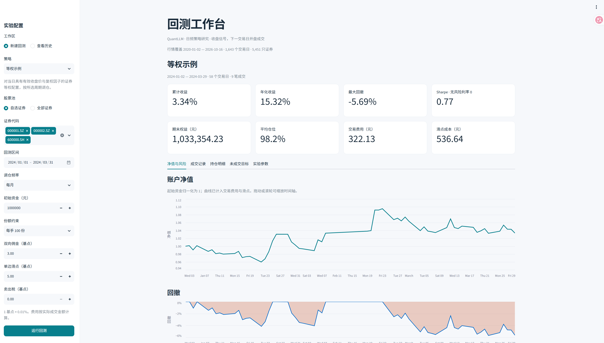
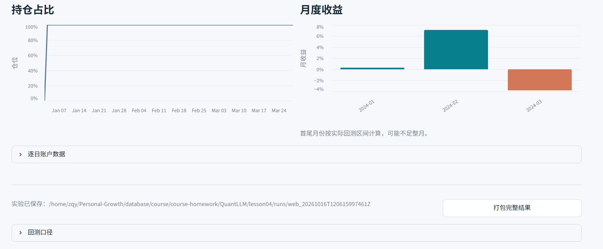

# 第四讲：日频回测系统

老师指定的10亿元、2025年初至2026年9月底选股研究，使用独立的
`research/assignment/` 流程和历史逐日ST数据。最终方案与结果见
[独立审计报告](ASSIGNMENT_AUDITED_REPORT.md)，规则见
[后续探索协议](research/assignment/FOLLOWUP_PROTOCOL.md)。第一轮总波动选股未跑赢大盘，
[否定报告](ASSIGNMENT_ROUND1_REPORT.md)和原始结果仍保留。
最终流程启用正常方向涨跌停、首日使用前收盘信号建仓、最后5日分批退出且末日清仓、历史成交额容量限制。
下文通用演示和旧反转实验的默认设置仍保留；本次结果是已接触目标区间后的探索，不代表未来保证。

```bash
# 免费公开行情，无需填写账号或密钥；支持缓存续跑。
uv run python -m research.assignment.fetch_data --workers 4
uv run python -m research.assignment.fetch_indices
uv run python -m research.assignment.data_quality

# 输出目录必须不存在，保存全部对照及敏感性结果。
MPLCONFIGDIR=/tmp/quantllm-lesson04-matplotlib uv run python -m research.assignment.run_followup --output research/assignment/reproduction
uv run python -m research.assignment.audit --results research/assignment/reproduction
uv run python -m research.assignment.make_followup_report --results research/assignment/reproduction --report ASSIGNMENT_REPRODUCTION_REPORT.md
```

历史状态缓存由下载器重建，逐文件哈希写入实验结果。最终 `MarketDeviationStrategy` 在
`backtest/market_deviation_strategy.py`，符合现有 `on_close` 协议；需要 `is_st` 等外部历史状态，不能直接使用没有历史ST数据的网页演示股票池。
`FactorSelectionStrategy` 和第一轮入口 `research.assignment.run` 保留用于复现失败实验。

本地 Feather 行情 → 策略在收盘后产生目标权重 → 下一交易日开盘撮合 → 逐日账户估值 → 绩效与成交记录。

当前版本用于多证券、只做多、无杠杆的策略研究。策略与资金账户、撮合、绩效统计分离，可以替换策略而复用相同的回测口径。

## 快速运行

本项目使用 Python 3.12 和 `uv` 管理环境。首次运行请先按 [REQUIREMENTS.md](REQUIREMENTS.md) 下载并解包课程行情，得到 `feathers/` 目录；原始行情不随源码重复上传。在本目录执行：

```bash
uv sync --locked
source .venv/bin/activate

# 先以三个证券、一个季度验证流程；等权策略仅作接口示例。
python -m backtest \
  --symbols 000001.SZ 000002.SZ 600000.SH \
  --start 2024-01-01 --end 2024-03-31

# 使用全部证券；零碎份额用于观察全市场等权表现。
python -m backtest --start 2024-01-01 --end 2024-12-31 --lot-size 0

python -m backtest --help
```

默认每次输出到新的 `runs/<UTC时间戳>/`，已被 Git 忽略。`--output` 可以指定尚不存在的输出目录。全市场读取 7 个矩阵并保留副本，内存开销可达约 1–2 GB，长期回测的逐日持仓记录还会增加内存用量；建议先用少量证券和较短区间调试。

## 可视化工作台

```bash
source .venv/bin/activate
streamlit run app.py
```

在浏览器打开 <http://127.0.0.1:8501>。默认只监听服务器本机地址。在远程服务器上运行时，可在自己的电脑上转发端口：

```bash
ssh -N -L 8501:127.0.0.1:8501 用户名@服务器地址
```

然后用自己电脑的浏览器打开同一个地址。若端口被占用，使用 `streamlit run app.py --server.port 8502`，并相应调整转发端口。

若服务器已连接 Tailscale，也可直接监听它的私网地址：

```bash
streamlit run app.py --server.address "$(tailscale ip -4)" --server.port 8501
```

自己的电脑保持 Tailscale 在线，然后打开 `http://服务器的Tailscale地址:8501`，无需 SSH 本地转发。此入口仅绑定指定的 Tailscale 地址。Windows 上若 SSH 转发出现 `bind [127.0.0.1]:端口: Permission denied`，可使用此方式访问；该报错是 Windows 本地监听失败，单凭报错不能确定是端口排除范围、程序独占还是其他本机策略。

- **新建回测**：选择已注册策略、自选或全市场股票池、起止日期、调仓周期、初始资金、整手或零碎份额，以及佣金、滑点和卖出税。费用输入使用基点，1 基点为 0.01%。仅点击「运行回测」才计算，修改参数不会重算或改变已有实验。
- **结果面板**：查看完整实验的绩效指标、可缩放和悬停查看的净值/回撤/仓位曲线、月度收益，以及成交方向、证券与日期筛选、每日持仓、未成交原因。明细筛选不会重新计算完整实验的指标。
- **历史实验**：浏览 `runs/` 中已保存的结果，兼容命令行输出。可在首页打开最近一次实验；载入历史无需重新运行回测，原始行情不可用时也可浏览结果。
- **导出**：每次运行自动保存到新的 `runs/web_<UTC时间戳>/`，同时记录实际参数、股票池及行情文件时间/大小。可下载筛选后的 CSV，或点击「打包完整结果」后下载包含所有原始产物的 ZIP。

页面入口为 `app.py`，实验管理和策略注册在 `backtest/dashboard.py`。后续策略实现 `on_close` 后，在 `STRATEGIES` 中增加一项 `StrategySpec(说明, factory)`；工厂接收 `daily/weekly/monthly` 调仓周期，并返回新的策略实例，页面的策略选项会自动更新。页面通过同一个 `BacktestEngine` 执行，不维护另一套回测逻辑。

默认行情目录和结果目录相对于 `app.py` 定位，支持用 `QUANTLLM_DATA_DIR`、`QUANTLLM_RUNS_DIR` 环境变量指定其他目录。仅轻量行情元数据使用跨页面缓存；完整行情按需加载，当前结果和下载包保留在各自浏览器会话中。

## 界面演示

回测工作台总览：参数配置、绩效指标、账户净值与回撤。



持仓占比、月度收益与实验结果导出。



## 开发策略

实现 `on_close(context)`，返回以证券代码为索引的 `pd.Series`：

```python
import pandas as pd
from backtest import BacktestConfig, BacktestEngine, MarketData


class MyStrategy:
    def on_close(self, context):
        # 历史数据的每一行是交易日，每一列是证券。
        # 最后一行是 context.date；允许读取回测起点之前的历史作预热。
        close = context.history("close", lookback=21, adjusted=True)
        if len(close) < 21:
            return None
        # 在这里实现选股和仓位规则。以下仅示范全仓持有一个证券。
        return pd.Series({"000001.SZ": 1.0})


data = MarketData.from_feathers("feathers", symbols=["000001.SZ"])
config = BacktestConfig(start="2024-01-01", end="2024-12-31")
result = BacktestEngine(data, config).run(MyStrategy())
print(result.metrics)
result.save("runs/my_first_strategy")
```

- `None`：保持持仓，不发新订单。由于价格波动，现有权重可以自然漂移。
- 空 `Series`：目标为全部现金；在下一交易日尝试清仓。
- 非空 `Series`：目标权重必须有限、非负，总和不超过 1；未列出的证券目标为零，剩余权重留现金。
- `context.history(field, lookback=None, adjusted=False)`：只返回截至当日的历史副本，不包含未来行。`adjusted=True` 仅支持 `open/high/low/close`，计算为原始价格乘累计复权因子，不采用全样本最后一天作归一化。
- `context.date/cash/equity/positions/weights`：当日收盘后的日期、现金、权益、份额和持仓权重。`positions/weights` 包含完整证券索引。
- 每次实验都创建新的策略实例，避免示例策略的调仓周期状态跨实验延续。`_data`、`_row` 是内部实现，不属于策略公开接口；不要从内部对象直接读取全样本。

## 交易和估值口径

1. 回测区间包含起止日；第一天收盘才生成第一笔信号，第一天资金保持现金。区间前的数据仅供历史预热，不提前建仓。最后一天收盘信号不会成交，期末按市值结算，不强制卖出。
2. 信号在下一个数据交易日开盘执行一次。先根据当日开盘权益计算目标份额，先卖再买。买入资金不足时按比例缩放买单并向下整手取整，不允许负现金、做空或杠杆；目标权重因费用、取整、缺价而可能无法完全达到。
3. 缺失或非正开盘价按停牌近似，目标顺延到可判定成交的下一日；新信号替代旧目标。缺复权因子禁止成交；启用涨跌停门禁时，前一行原始收盘价缺失也禁止成交，已顺延目标继续等待可判定的前收。这里不前填任何成交价。普通缺复权因子订单不自动重试。
4. 买入价为 `open * (1 + slippage)`，卖出价为 `open * (1 - slippage)`。佣金按双向实际成交金额收取。`sell_tax=None` 为默认历史分段：实际卖出日早于 2023-08-28 时收取 0.1%，当日及之后收取 0.05%；买入不收。显式传入数值则使用固定费率。滑点已经体现在成交价中，统计时单独列出其成本，不重复扣款。
5. 通用引擎默认初始资金 100 万、佣金率 `0.0003`、滑点率 `0.0005`、历史印花税、每手 `100` 份。反转信号体检按 STRATEGY.md 另固定使用每边 `0.0015`，并未采用通用界面的较低默认成本。尚无最低佣金和分时变化佣金。`lot_size=0` 允许零碎份额；部分减仓向下整手取整，清仓允许卖完零碎份额。
6. 持仓份额按相邻有效 `cumadj` 的比率调整，同时反向调整旧估值价格，使权益与复权总收益一致。这是**总收益、分红再投资的合成持仓模型**，份额不一定对应券商真实股数，不模拟分红到账、税差或配股认购。复权因子缺失时暂停更新该证券估值与成交，恢复后一次性补齐因子比率。
7. 当日有效收盘价优先用于估值；缺收盘价时使用当日有效开盘价，否则沿用上次有效估值，并在 `stale_positions` 和持仓 `stale` 中标记。不会用未来价格回填。长期停牌或退市后的残留持仓可能高估可变现价值，需检查这些标记。
8. 默认按 STRATEGY.md 的方向执行“跌停不买、涨停不卖”，使用原始开盘与前收：300/301/688 前缀按 20%，其余按 10%。涨跌停跳过不补仓、不延迟，预算留现金。缺 ST 字段、历史板块制度、官方除权参考价和涨跌停取整规则，因此仅为近似。`apply_price_limits=False` 可显式关闭，仅供对照或合成测试。全天最终成交额、成交笔数、最高价和最低价不用于开盘撮合；不模拟盘口排队、成交量上限或真实证券状态，也不保证规格门禁允许的其他订单现实可成交。

数据层要求各字段的日期和证券列严格一致，日期唯一且升序；保留 NaN，不前填成交价。面板历史证券覆盖尚未得到完整证明，存在幸存者和覆盖偏差风险，历史收益可能偏乐观；含有部分历史退市代码也不能据此排除偏差。策略自身的选股逻辑和外部信息也需单独检查时间戳。

100 万资金等权分配给数千只股票时，很多单股预算低于一手成本，会导致大量现金闲置。可缩小股票池、增加资金，或用 `--lot-size 0` 研究零碎份额模型；应同时查看 `final_cash` 和 `average_exposure`，后者为每日持仓市值占权益比例的平均值。

## 输出和指标

| 文件 | 内容 |
| --- | --- |
| `equity.csv` | 每日权益、现金、市值、收益率、成交额换手率、费用、滑点成本、持仓数和缺价数 |
| `trades.csv` | 成交日、信号日、证券、方向、份额、开盘价、成交价、费用与成交后现金 |
| `positions.csv` | 每日非零持仓、估值价格、市值、权重与缺价标记 |
| `rejected_orders.csv` | 涨跌停、开盘价、前收或复权因子受阻的目标；`deferred` 标明停牌顺延；整手取整为零不计入 |
| `metrics.json` | 总收益、年化收益/波动率、零无风险利率 Sharpe、最大回撤、费用、滑点成本和平均换手率 |
| `config.json` | 账户、撮合和统计参数 |
| `experiment.json` | CLI 示例策略、股票池、数据路径与数据覆盖区间，仅 CLI 生成 |
| `equity.png` | 净值和回撤图 |

日收益含交易费用与滑点；年化默认使用每年 `252` 个交易日和实际回测记录天数。波动率使用日收益样本标准差；零波动时 Sharpe 为 `null`。回撤高水位包含初始资金。换手率定义为**买入与卖出原始开盘价金额之和 / 当日开盘权益**，不是单边换手率。`stale_position_days` 是逐日缺价持仓数之和。

当前不提供默认市场基准，也不计算 alpha/beta；比较策略时应使用相同区间、股票池、费用和成交口径。

涨跌停阻止比例以所有取整前非零目标变动的订单尝试为分母，停牌重试也分别计次。停牌顺延另按 `(signal_date, symbol)` 去重，输出 `suspended_unique_orders / unique_order_intents`；`deferred_fills` 为顺延实际成交数。T+1 通过卖出先于买入、可卖份额不超过开盘前持仓来约束。

## 短期反转信号体检

唯一策略规格见 [STRATEGY.md](STRATEGY.md)，运行前固定的统计口径见 [research/PROTOCOL.md](research/PROTOCOL.md)，实际结论见 [REPORT.md](REPORT.md)。

```bash
uv run python -m research.signal_health --data feathers --output research/results/reversal_default
uv run python -m research.make_report --results research/results/reversal_default
```

体检不运行资金账户，保存池成员、选股与各期限收益明细、日度统计、分年度对照、成本敏感性和闸门结果。输出目录不得已存在；复现时使用新的 `--output` 路径，保留首次结果。若 5 日净超额闸门失败，则停止阶段 2，不生成策略净值或宣称已通过基准检验。

## 验证与代码结构

```bash
MPLCONFIGDIR=/tmp/quantllm-lesson04-matplotlib python -m unittest discover -s tests -v
```

`backtest/data.py` 管理行情和策略上下文，`strategy.py` 定义接口与等权示例，`engine.py` 负责逐日撮合和账户，`result.py` 统计并导出，`__main__.py` 提供命令行，`dashboard.py` 为网页提供实验管理。测试使用小型合成行情验证时序、费用、复权、停牌缺价、资金约束、整手、数据边界及结果保存；`tests/test_dashboard.py` 使用 Streamlit AppTest 验证表单提交、参数传递、结果图表、明细筛选、历史加载和导出。

环境和课程原始要求见 [REQUIREMENTS.md](REQUIREMENTS.md)。若代理下依赖下载缓慢，使用 `UV_CONCURRENT_DOWNLOADS=2 uv sync --locked`；默认缓存不可写时添加 `--cache-dir /tmp/quantllm-lesson04-uv-cache`。

## 策略补充提交的归档

主实验明细可直接浏览，其他大体积对照明细见 [提交归档说明](submission/README.md)；重新审计已有完整结果前请先解压。
