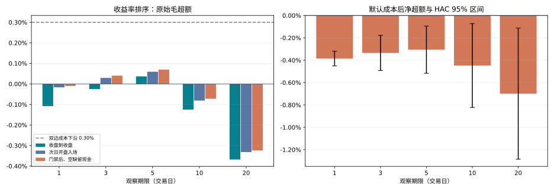
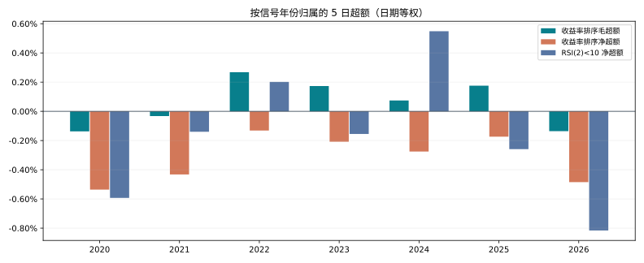
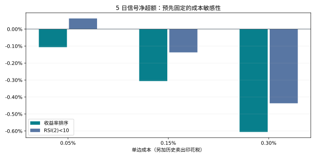

# 短期反转策略验证报告

## 结论：默认策略不能通过盈利闸门，停止投入阶段 2

按 `STRATEGY.md` §7，**本次策略方向淘汰，不认定为能挣钱**。成交额前 500 中取过去 5 日最跌 20 只，次日开盘入场、观察 5 日、跌停份额留现金后，平均毛超额仅 **0.0694%**，小于估计双边成本 **0.3755%**；净超额 **-0.3060%**。Newey–West 20 滞后的 95% 区间为 **[-0.5168%, -0.0952%]**，完全低于零。

这不仅是跑输池均值：该口径的 5 日组平均毛收益为 -0.1203%，扣估计成本后为 -0.4958%；池均值为 -0.1897%。这些是重叠信号组的期限收益均值，**不是资金账户的累计、年化收益或净值**，不能累乘成策略曲线。结论限定于本规格、默认参数、历史样本与成本模型，不是断言所有反转策略永远亏损。

阶段 1 已触发第一条失败条件，因此**未开发 `RollingReversalStrategy`、未运行阶段 2、未生成策略净值/年化/Sharpe/换手率或三基准回测图**。§7 第四条净值基准判据尚未检验，不能写成已通过。后面的 RSI 和 regime 表只解释既定体检，不替换失败的主策略。

## 一、事前固定方法与数据边界

策略权威：[STRATEGY.md](STRATEGY.md)。分析前固定口径：[research/PROTOCOL.md](research/PROTOCOL.md)。脚本：[research/signal_health.py](research/signal_health.py)，不调用回测引擎；读取本地 `open/close/amt/cumadj` 四个矩阵。数据形状、日期、复权乘法和幸存者偏差直接采用任务提供的已核实事实，不重复做数据口径研究。

首个实际信号日为 **2020-04-02**，最后一个为 **2026-10-16**。先按已观测上市年龄筛选，再对当日正成交额排名取池；未来是否可买只影响执行诊断，不能反过来更换入选股票。收益率排序共 1,584 个信号日、31,680 个目标；有下一开盘的目标为 31,660，5 日期限完整的目标为 31,560。

所有价格比率使用 `(原始价 × 当日 cumadj)` 的端点比，成交门禁只用原始前收和开盘价。主口径为 **t+1 开盘 → t+1+h 开盘**，h=5 代表买入后跨 5 个交易日间隔；h=1 也不在买入当天卖出。另列 t 收盘→t+h 收盘的原始描述，避免把两者混为一谈。

每个信号日先算所选组等权收益减信号日固定池的同期均值，再对日期等权平均。池内缺未来端点者不进入该日池收益分母，原定已买组只要有未知期限收益则整组记缺失；缺价绝不填零或前填成可交易。只有明确未买入的份额才记录现金收益 0，保留原目标权重。末端未到期另记右删失。成本只扣在信号组，池均值不扣成本，这是相对严格的成本覆盖检验。

## 二、1/3/5/10/20 日超额与成本覆盖

下表为主口径：次日开盘可入场者持有，不可入场的原定份额留现金。金额比例均为每个期限的收益率，不是百分点以外的累计倍数。

| 期限 | 有效信号日 | 组毛收益 | 池毛收益 | 毛超额 | 估计双边成本 | 净超额 | 净超额95%下界 | 95%上界 |
| --- | --- | --- | --- | --- | --- | --- | --- | --- |
| 1 | 1582 | -0.0527% | -0.0427% | -0.0100% | 0.3755% | -0.3855% | -0.4510% | -0.3200% |
| 3 | 1580 | -0.0870% | -0.1272% | 0.0403% | 0.3755% | -0.3352% | -0.4924% | -0.1781% |
| 5 | 1578 | -0.1203% | -0.1897% | 0.0694% | 0.3755% | -0.3060% | -0.5168% | -0.0952% |
| 10 | 1573 | -0.3238% | -0.2516% | -0.0722% | 0.3754% | -0.4475% | -0.8224% | -0.0727% |
| 20 | 1563 | -0.5449% | -0.2212% | -0.3237% | 0.3752% | -0.6989% | -1.2849% | -0.1129% |

主口径的缺失与末端删失计数（按信号组日期，不按个股）：

| 期限 | 有效信号日 | 未到期日期 | 已到期但估值缺失日期 |
| --- | --- | --- | --- |
| 1 | 1582 | 2 | 0 |
| 3 | 1580 | 4 | 0 |
| 5 | 1578 | 6 | 0 |
| 10 | 1573 | 11 | 0 |
| 20 | 1563 | 21 | 0 |

原始收盘到收盘描述（不意味着可按信号日收盘价成交）：

| 期限 | 有效日期 | 收盘到收盘毛超额 | 减成本后的诊断值 |
| --- | --- | --- | --- |
| 1 | 1583 | -0.1079% | -0.4840% |
| 3 | 1581 | -0.0250% | -0.4010% |
| 5 | 1579 | 0.0366% | -0.3394% |
| 10 | 1574 | -0.1249% | -0.5009% |
| 20 | 1564 | -0.3679% | -0.7437% |

次日开盘但尚未施加门禁的描述：

| 期限 | 有效日期 | 开盘到开盘毛超额 | 减成本后的诊断值 |
| --- | --- | --- | --- |
| 1 | 1582 | -0.0167% | -0.3928% |
| 3 | 1580 | 0.0292% | -0.3469% |
| 5 | 1578 | 0.0593% | -0.3167% |
| 10 | 1573 | -0.0810% | -0.4570% |
| 20 | 1563 | -0.3317% | -0.7075% |

默认单边 0.15% 加历史卖出税，对实际投入份额的名义双边门槛为税改前 0.40%、税改后 0.35%；组平均成本因少量份额留现金为 0.3755%。5 日毛超额连较宽松的 0.30% 门槛也未达到，其毛超额 95% 上界为 0.2799%。不是通过降低成本、改持有期或挑年份才作出默认结论。



## 三、年度稳定性：2020—2026

按信号年份归属；到期跨年不挪动信号年份。2020 受左端上市年龄预热影响，2026 为截至给定数据末日的部分年度，并排除未到期观察。

| 年份 | 收益率组日期 | 收益率排序毛超额 | 平均成本 | 收益率排序净超额 | RSI日期 | RSI毛超额 | RSI净超额 |
| --- | --- | --- | --- | --- | --- | --- | --- |
| 2020 | 184 | -0.1373% | 0.3988% | -0.5361% | 179 | -0.1943% | -0.5928% |
| 2021 | 243 | -0.0325% | 0.3998% | -0.4323% | 243 | 0.2599% | -0.1400% |
| 2022 | 242 | 0.2679% | 0.3994% | -0.1315% | 242 | 0.6013% | 0.2016% |
| 2023 | 242 | 0.1732% | 0.3812% | -0.2081% | 242 | 0.2263% | -0.1550% |
| 2024 | 242 | 0.0743% | 0.3496% | -0.2753% | 230 | 0.8983% | 0.5486% |
| 2025 | 243 | 0.1757% | 0.3493% | -0.1736% | 243 | 0.0907% | -0.2589% |
| 2026 | 182 | -0.1358% | 0.3491% | -0.4850% | 182 | -0.4662% | -0.8160% |

主信号有 4/7 个年份毛超额为正，故没有触发“只有 1–2 年贡献”这一特定失败项；但是 **7/7 年默认成本后净超额为负**，不能认为年度盈利稳定。不能把某条失败项未触发解释为整体通过。

### 各期限分年度毛超额

| 年份 | 1日 | 3日 | 5日 | 10日 | 20日 |
| --- | --- | --- | --- | --- | --- |
| 2020 | -0.0420% | -0.0364% | -0.1373% | -0.7636% | -1.2241% |
| 2021 | -0.0445% | -0.0554% | -0.0325% | 0.2006% | -0.2300% |
| 2022 | 0.0350% | 0.1373% | 0.2679% | 0.0436% | 0.1558% |
| 2023 | -0.0237% | 0.1064% | 0.1732% | 0.5675% | 0.9284% |
| 2024 | 0.0562% | 0.1891% | 0.0743% | -0.7628% | -1.0922% |
| 2025 | 0.0927% | 0.2014% | 0.1757% | 0.1269% | -0.5661% |
| 2026 | -0.1940% | -0.3802% | -0.1358% | -0.0897% | -0.5105% |

### 各期限分年度净超额

| 年份 | 1日 | 3日 | 5日 | 10日 | 20日 |
| --- | --- | --- | --- | --- | --- |
| 2020 | -0.4408% | -0.4352% | -0.5361% | -1.1624% | -1.6229% |
| 2021 | -0.4443% | -0.4551% | -0.4323% | -0.1992% | -0.6298% |
| 2022 | -0.3644% | -0.2622% | -0.1315% | -0.3559% | -0.2437% |
| 2023 | -0.4057% | -0.2752% | -0.2081% | 0.1873% | 0.5503% |
| 2024 | -0.2935% | -0.1605% | -0.2753% | -1.1124% | -1.4419% |
| 2025 | -0.2566% | -0.1478% | -0.1736% | -0.2224% | -0.9154% |
| 2026 | -0.5432% | -0.7293% | -0.4850% | -0.4388% | -0.8595% |



## 四、跌停无法买入与可执行性

收益率排序在有入场开盘的 31,660 个目标中，**47 个次日开盘触发跌停不买，占 0.1485%**。RSI 对照为 26/27,385，占 0.0949%。分母是证券目标事件，不是去重证券数，也不是交易日数；样本最后一天没有下一开盘，不混入该分母。

| 信号 | 年份 | 已观测开盘目标 | 跌停目标 | 跌停比例 | 可入场比例 | 缺开盘 | 缺因子 | 缺前收 |
| --- | --- | --- | --- | --- | --- | --- | --- | --- |
| reversal | 2020 | 3680 | 11 | 0.2989% | 99.7011% | 0 | 0 | 0 |
| reversal | 2021 | 4860 | 3 | 0.0617% | 99.9383% | 0 | 0 | 0 |
| reversal | 2022 | 4840 | 7 | 0.1446% | 99.8554% | 0 | 0 | 0 |
| reversal | 2023 | 4840 | 2 | 0.0413% | 99.9587% | 0 | 0 | 0 |
| reversal | 2024 | 4840 | 5 | 0.1033% | 99.8967% | 0 | 0 | 0 |
| reversal | 2025 | 4860 | 10 | 0.2058% | 99.7942% | 0 | 0 | 0 |
| reversal | 2026 | 3740 | 9 | 0.2406% | 99.7594% | 0 | 0 | 0 |
| rsi2 | 2020 | 2812 | 8 | 0.2845% | 99.7155% | 0 | 0 | 0 |
| rsi2 | 2021 | 4388 | 2 | 0.0456% | 99.9544% | 0 | 0 | 0 |
| rsi2 | 2022 | 4409 | 4 | 0.0907% | 99.9093% | 0 | 0 | 0 |
| rsi2 | 2023 | 4640 | 2 | 0.0431% | 99.9569% | 0 | 0 | 0 |
| rsi2 | 2024 | 4018 | 3 | 0.0747% | 99.9253% | 0 | 0 | 0 |
| rsi2 | 2025 | 3819 | 5 | 0.1309% | 99.8691% | 0 | 0 | 0 |
| rsi2 | 2026 | 3299 | 2 | 0.0606% | 99.9394% | 0 | 0 | 0 |

原始数量低于事前 20% 红线，不是本次失败的主因。按默认 5 日期限，可入场的 31,513 个收益率排序目标中，到期原始开盘触发涨停不卖的有 41 个（0.1301%）；RSI 为 26/27,259（0.0954%）。体检只是到期市值诊断，**没有把这些目标伪装成已卖出成交**。完整退出账本只属于闸门通过后的阶段 2。

## 五、RSI(2)<10 对照

Wilder(2) 连续价差初始化，缺价重置，双零时 50；阈值固定 10，最多取 20 只。RSI 共 1,567 个信号日，每日平均 17.49 只，少于 20 时按实际数量等权。因此须同时报告共有日期配对，而不能仅比较各自全样本均值。

| 期限 | 共有有效信号日 | 收益率排序毛超额 | RSI毛超额 | RSI减收益率排序 |
| --- | --- | --- | --- | --- |
| 1 | 1565 | -0.0172% | 0.0395% | 0.0567% |
| 3 | 1563 | 0.0175% | 0.1312% | 0.1138% |
| 5 | 1561 | 0.0458% | 0.2386% | 0.1928% |
| 10 | 1556 | -0.0756% | 0.2961% | 0.3717% |
| 20 | 1545 | -0.3069% | 0.2692% | 0.5761% |

在相同有效日期上，RSI 的毛超额更高，但这不表示默认成本下可以赚钱；两组持仓数量也并非完全相同。默认成本的 5 日配对净超额如下：

| 共有有效日期 | 收益率排序净超额 | RSI净超额 | RSI相对改善 |
| --- | --- | --- | --- |
| 1561 | -0.3298% | -0.1371% | 0.1927% |

## 六、事前固定成本敏感性与默认 regime 诊断

以下是**信号层成本门槛敏感性，不是阶段 2 回测**。没有搜索收益最优的 N/K/L/H/MA；没有因 RSI 在低成本档改善就替换主策略。

| 信号 | 单边成本 | 有效日期 | 5日净超额 |
| --- | --- | --- | --- |
| reversal | 0.0500% | 1578 | -0.1063% |
| reversal | 0.1500% | 1578 | -0.3060% |
| reversal | 0.3000% | 1578 | -0.6056% |
| rsi2 | 0.0500% | 1561 | 0.0627% |
| rsi2 | 0.1500% | 1561 | -0.1371% |
| rsi2 | 0.3000% | 1561 | -0.4369% |

原策略在最低 0.05% 单边成本档仍为负。RSI 在最低成本档的正值只说明其成本容忍度较高，不能覆盖默认成本，也不作为本任务继续开发的依据。



合成市场代理以全市场相邻有效复权价日收益等权累乘、基值 1，前 200 日不允许 regime=True。此指数不是实际可投资指数，不含真实指数成分和交易摩擦；缺价改变每日参与证券数，且仍受幸存者偏差影响。仅在默认 `M>MA200` 日期内的 5 日诊断如下，不改变主闸门：

| 信号 | 趋势内有效日期 | 毛超额 | 默认成本后净超额 | 净超额95%下界 | 95%上界 |
| --- | --- | --- | --- | --- | --- |
| reversal | 905 | 0.1041% | -0.2712% | -0.5095% | -0.0329% |
| rsi2 | 897 | 0.1491% | -0.2267% | -0.4878% | 0.0344% |

该表也不构成持有到期的资金账户。因主闸门失败，本次未选择任何进一步 regime 优化、子组合或择时参数。

## 七、参数：默认、实际值与依据

| 参数 | 默认/本次实际 | 依据与性质 |
| --- | --- | --- |
| N / K / L | 500 / 20 / 5 | 规格经验起点：流动性、分散和短期反转；均未由本数据优化 |
| H | 5 | 规格默认；本次为固定期限信号诊断，不是已执行持有账本 |
| MA | 200 | 规格长期趋势经验窗口；只作默认 regime 子样本诊断 |
| MIN_LISTED | 60 | 规格经验门槛；实际用面板首次有效收盘至今的交易日年龄近似真实上市年龄 |
| 首 200 日 | regime=False | 规格明确预热；原始信号体检仍从满足 MIN_LISTED 时开始 |
| RSI_PERIOD / RSI_THRESHOLD | 2 / 10 | 规格固定备选；Wilder 初始化、缺口重置和最多 K 只是事前实现约定 |
| 各期限 | 1 / 3 / 5 / 10 / 20 | 任务指定，未择优选择其中一期替代 H=5 |
| 每边成本 | 0.15% | 规格默认，佣金/过户/滑点合计的研究假设，不是数据测得实际费用 |
| 成本敏感性 | 0.05% / 0.15% / 0.30% | 任务指定的三档，不挑最好的一档作主结论 |
| 卖出印花税 | 0.1% / 0.05%，2023-08-28 切换 | 任务提供的已确认历史事实；按到期日计，买入不收 |
| 板块涨跌幅 | 300/301/688=20%，其余=10% | 任务指定代码近似，不是已知真实证券状态；ST 5% 无法识别 |
| 跌停比率红线 | >20% | 规格举例，事前固定为停止红线；本次未触发 |
| HAC 滞后 / 区间 | 20 / 正态近似95% | 事前统计约定，覆盖最长观察窗；不是独立同分布 t 检验 |
| 日度/组内权重 | 日期等权 / 原定组等权 | 事前约定；缺席份额留现金，不补标的 |
| RSI 不足20只 | 实际数量等权 | 事前对照约定；因此另报共有信号日对照 |
| 买入/卖出端点 | t+1 / t+1+h 原始开盘对应复权收益比 | 无未来选股；真实价格与收益率口径分离 |
| 初始资金/手数/账户费率 | 阶段1不使用 | 没有运行账户；不把通用引擎100万、100份及较低成本默认值混入本分析 |

完整机器可读参数与输入/代码哈希：[manifest.json](research/results/reversal_default/manifest.json)。有限敏感性只涉及预先指定成本，未调主信号其他参数。

## 八、系统修复与验证

- `backtest/market_rules.py`：历史印花税与原始价格门禁。严格保留规格方向：跌停不买、涨停不卖；不能将其偷偷替换成另一套门禁。
- `backtest/engine.py`：默认启用门禁；涨跌停不补仓、不顺延；停牌单独顺延，新目标替代旧目标；买单预算不向其他标的再分配；卖出数量不超过开盘前持仓；记录实际卖出税率、受阻原因及顺延。
- 引擎统计门禁受阻/尝试比例和停牌目标去重顺延比例。前收缺失时不猜涨跌停价，已顺延订单继续等待可判定的开盘；复权缺失不成交。
- CLI 和工作台默认历史印花税，也保留明确选择固定费率的对照模式；旧实验固定税率不被篡改。工作台展示门禁和顺延统计。

验证记录：完整测试返回码 **0**，测试数 **63**；中间输出独立核对 **885** 项，结果 **True**。日志见 [tests.log](research/results/reversal_default/tests.log)、[verification.json](research/results/reversal_default/verification.json)、[audit.json](research/results/reversal_default/audit.json)。

## 九、诚实限制与实盘可能更差的原因

1. **已确认幸存者偏差**：面板仅当前仍在的 5451 只，退市失败样本缺失，历史收益可能偏乐观。没有退市标记，不能用该结果证明覆盖退市损失。
2. **没有真实指数、成分、市值或行业**：M 是合成近似，成交额前500是流动性池而非大盘股/指数成分；没有行业中性化或市场风险匹配，超额不是回归 alpha。
3. **涨跌幅近似不完整**：无 ST 标记导致真实5%限制漏判；未重建创业板历史制度变化、IPO无涨跌幅期、除权官方参考价与分币取整。原始前收除权跳变也可能被门禁误识别，不能因此改用复权价判停。
4. **规格门禁并非实盘成交保证**：只实现指定的跌停买入、涨停卖出禁令；其他封板方向、排队、开盘集合竞价成交容量与时间戳误差均可能使实际成交更差。high/low 是盘后信息，不能拿来改善开盘撮合。
5. **信号层而非完整交易账本**：逐日信号期限互相重叠；没有把它们当作每日可全额重建的独立本金。没有阶段2净值，不能引用年化、Sharpe、最大回撤或换手率来宣传。体检入场缺席留现金，停牌真正顺延与到期退出受阻仍可能进一步降低真实表现。
6. **成本是假设不是报价**：单边合计成本线性扣减，未计最低佣金、个股冲击、容量、价差差异和成本随成交量变化；这些可能使成本更高。印花税按任务确认的真实分段处理。
7. **复权是总收益口径**：cumadj 只计算收益端点比；真实买入价格绝不是 close*cumadj 的数值。通用引擎既有因子比率合成份额模型不等于分红到账、税差、配股及再投资的真实路径。
8. **上市日期近似与缺失样本**：面板左侧不可见真实上市历史，MIN_LISTED保守预热；池均值仅用当期限有效端点，其缺失分母可能改变比较。样本末端未到期单独删失，绝不补零，完整计数见 daily/summary 和逐目标记录。
9. **统计不确定性**：跨年可能变号、信号自相关、重叠收益、样本长度有限及合成池风险暴露均影响显著性；HAC区间只是固定口径的近似，不消除选择偏差或市场非平稳性。

## 十、可追溯产物与复现

```bash
uv run python -m research.signal_health --data feathers --output research/results/reversal_reproduction
uv run python -m research.audit_outputs --results research/results/reversal_reproduction
MPLCONFIGDIR=/tmp/quantllm-lesson04-matplotlib uv run python -m unittest discover -s tests -v
uv run python -m research.make_report --results research/results/reversal_default
```

分析输出目录必须是新目录。最后一条从首次固定结果重新生成本报告，不覆盖数据或重新选择参数。新增复现目录也可传入 `make_report --results ... --report ...`；测试状态需另保存验证记录，不能复用首次记录冒充新实验。

| 产物 | 用途 |
| --- | --- |
| [pool_members.feather](research/results/reversal_default/pool_members.feather) | 每日原始池、金额、年龄、L日收益、RSI、行列索引 |
| [signal_observations.feather](research/results/reversal_default/signal_observations.feather) | 每个入选目标、入场原因、各期限端点与收益、退出涨停标记 |
| [daily.csv](research/results/reversal_default/daily.csv) | 三口径逐日组收益、池均值、净超额、有效分母、右删失 |
| [summary.csv](research/results/reversal_default/summary.csv)、[annual.csv](research/results/reversal_default/annual.csv) | 全期与分年度汇总及HAC区间 |
| [paired.csv](research/results/reversal_default/paired.csv) | 两信号共有日期的直接对照 |
| [availability.csv](research/results/reversal_default/availability.csv) | 按年份的目标、跌停及缺价计数 |
| [sensitivity.csv](research/results/reversal_default/sensitivity.csv) | 预定三档单边成本门槛 |
| [market_proxy.csv](research/results/reversal_default/market_proxy.csv)、[summary_regime.csv](research/results/reversal_default/summary_regime.csv) | 合成指数与默认regime诊断，非真实指数回测 |
| [gate.json](research/results/reversal_default/gate.json) | 明确通过/失败及停止原因 |
