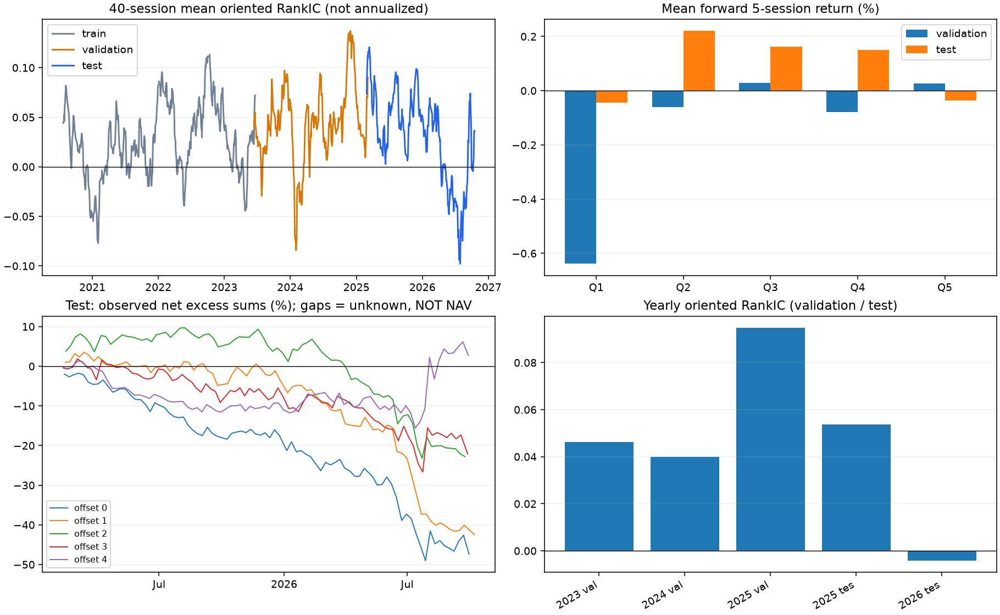
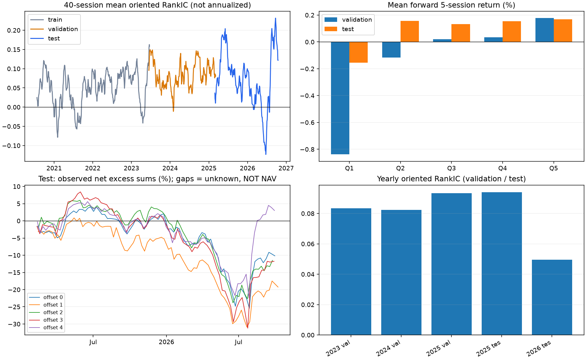
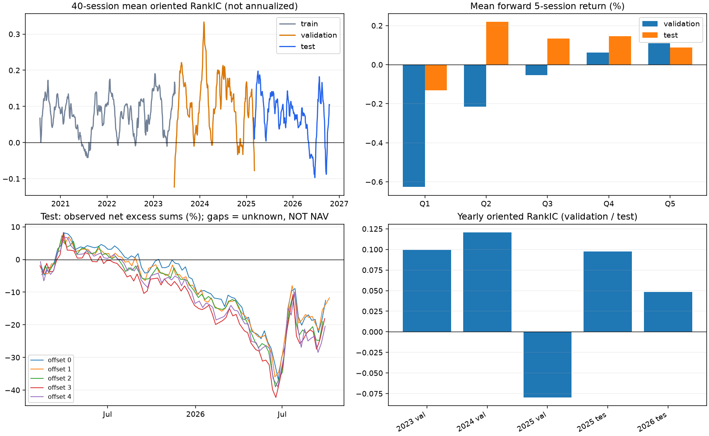

# 因子评价报告

**结论针对本次研究样本；诊断分数不替代硬门槛。** 候选按输入顺序展示，测试结果不用于重新选方向或调阈值。历史时间留出不等于前瞻验证；默认课程数据已在 lesson04 中使用。合成数据结果不能作为市场有效性证据。

标签：t 收盘因子 → t+1 复权开盘进入 → t+1+h 复权开盘退出；默认 h=5。train/validation 边界剔除跨区间标签；方向仅取训练期原始 RankIC 均值的符号。

分组按信号日有效因子排序；Q1 为低分组，Q5 为高分组（默认五组）。并列因子取平均秩，不人为拆开；分组不一定等大。基准为相同有效因子股票池的等权收益。缺任何计划成分的标签，该组当期收益不可用；不补仓、不事后重排。

每期假设独立完整买卖：多头扣 2×单边成本，多空价差扣 4×单边成本；基准不扣费。成本是配置情景，非税率或券商报价。多空价差为多空各 1 元名义头寸的差，未计融券费用，也不是资金组合收益。每日五日收益相互重叠，不能连乘为每日净值；图中只对各固定相位的非重叠观测超额求和，并明确标注缺失。

HAC 使用 Bartlett 权重，默认 10 阶（至少 h−1 阶），p 值为大样本双侧正态近似；ICIR 为均值/标准差，不做重叠样本的机械年化。FDR 仅校正本批次因子，不能涵盖过去未披露的筛选或反复调参；train 的显著性受方向拟合影响，仅作描述。

当前默认池只按历史价格长度和成交额筛选。未自动接入历史 ST、涨跌停、行业、市值、做空可得性与逐笔成交；未做行业/规模中性化。因此“好因子”表示研究指标通过，不能证明独立 alpha 或可实盘成交。可提供信号日 eligible 掩码以排除不合格证券。

## 5dr：不合格（当前定义与样本）

诊断分数 64.2/100；训练期冻结方向 -1；验证阶段准入：未通过；双倍成本压力：未通过。

| 区间 | IC天数 | RankIC | ICIR | HAC t | FDR q | 净多头超额/期 | 净多空价差/期 | 单调性 | 正IC月份 | 正超额相位 |
| --- | --- | --- | --- | --- | --- | --- | --- | --- | --- | --- |
| train | 696 | 0.0252 | 0.1780 | 2.8321 | 0.0046 | -0.16% | -0.05% | 0.4000 | 64.71% | 0.00% |
| validation | 405 | 0.0441 | 0.2549 | 3.1862 | 0.0014 | -0.03% | 0.26% | 0.5000 | 85.00% | 40.00% |
| test | 405 | 0.0277 | 0.1621 | 2.0730 | 0.0382 | -0.33% | -0.40% | 0.0000 | 80.00% | 20.00% |

判定依据：

- validation / long_excess_net：实测 -0.0003，门槛 >0；每期完整往返成本；多头须战胜同池未扣费等权基准，多空须有正价差
- validation / monotonicity：实测 0.5000，门槛 0.6；分层、跨月与五个固定非重叠起点的方向一致性
- validation / positive_offset_ratio：实测 0.4000，门槛 0.6；分层、跨月与五个固定非重叠起点的方向一致性
- test / long_excess_net：实测 -0.0033，门槛 >0；每期完整往返成本；多头须战胜同池未扣费等权基准，多空须有正价差
- test / long_short_net：实测 -0.0040，门槛 >0；每期完整往返成本；多头须战胜同池未扣费等权基准，多空须有正价差
- test / monotonicity：实测 0.0000，门槛 0.6；分层、跨月与五个固定非重叠起点的方向一致性
- test / positive_offset_ratio：实测 0.2000，门槛 0.6；分层、跨月与五个固定非重叠起点的方向一致性

逐日、分月、分年、非重叠相位、全部门槛见 `factor_01/`。

## momentum20：有潜力，但样本外未完全通过

诊断分数 81.7/100；训练期冻结方向 -1；验证阶段准入：通过；双倍成本压力：未通过。

| 区间 | IC天数 | RankIC | ICIR | HAC t | FDR q | 净多头超额/期 | 净多空价差/期 | 单调性 | 正IC月份 | 正超额相位 |
| --- | --- | --- | --- | --- | --- | --- | --- | --- | --- | --- |
| train | 696 | 0.0488 | 0.3059 | 4.1060 | 0.0001 | -0.13% | 0.02% | 0.2000 | 79.41% | 0.00% |
| validation | 405 | 0.0830 | 0.4561 | 5.3690 | 0.0000 | 0.12% | 0.62% | 1.0000 | 95.00% | 100.00% |
| test | 405 | 0.0741 | 0.3989 | 3.7841 | 0.0005 | -0.12% | -0.08% | 0.7000 | 80.00% | 20.00% |

判定依据：

- test / long_excess_net：实测 -0.0012，门槛 >0；每期完整往返成本；多头须战胜同池未扣费等权基准，多空须有正价差
- test / long_short_net：实测 -0.0008，门槛 >0；每期完整往返成本；多头须战胜同池未扣费等权基准，多空须有正价差
- test / positive_offset_ratio：实测 0.2000，门槛 0.6；分层、跨月与五个固定非重叠起点的方向一致性

逐日、分月、分年、非重叠相位、全部门槛见 `factor_02/`。

## volatility20：有潜力，但样本外未完全通过

诊断分数 78.3/100；训练期冻结方向 -1；验证阶段准入：通过；双倍成本压力：未通过。

| 区间 | IC天数 | RankIC | ICIR | HAC t | FDR q | 净多头超额/期 | 净多空价差/期 | 单调性 | 正IC月份 | 正超额相位 |
| --- | --- | --- | --- | --- | --- | --- | --- | --- | --- | --- |
| train | 696 | 0.0747 | 0.4297 | 5.9364 | 0.0000 | -0.12% | 0.02% | 0.7000 | 73.53% | 0.00% |
| validation | 405 | 0.1060 | 0.3991 | 3.7390 | 0.0003 | 0.05% | 0.34% | 1.0000 | 85.00% | 100.00% |
| test | 405 | 0.0753 | 0.3157 | 3.0427 | 0.0035 | -0.20% | -0.19% | 0.1000 | 80.00% | 0.00% |

判定依据：

- test / long_excess_net：实测 -0.0020，门槛 >0；每期完整往返成本；多头须战胜同池未扣费等权基准，多空须有正价差
- test / long_short_net：实测 -0.0019，门槛 >0；每期完整往返成本；多头须战胜同池未扣费等权基准，多空须有正价差
- test / monotonicity：实测 0.1000，门槛 0.6；分层、跨月与五个固定非重叠起点的方向一致性
- test / positive_offset_ratio：实测 0.0000，门槛 0.6；分层、跨月与五个固定非重叠起点的方向一致性

逐日、分月、分年、非重叠相位、全部门槛见 `factor_03/`。
