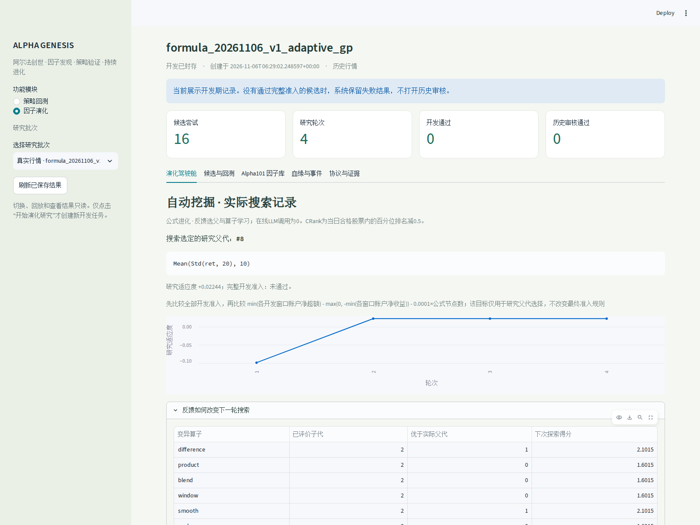
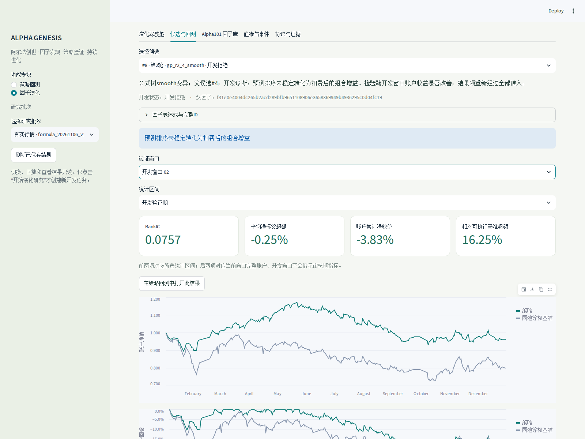
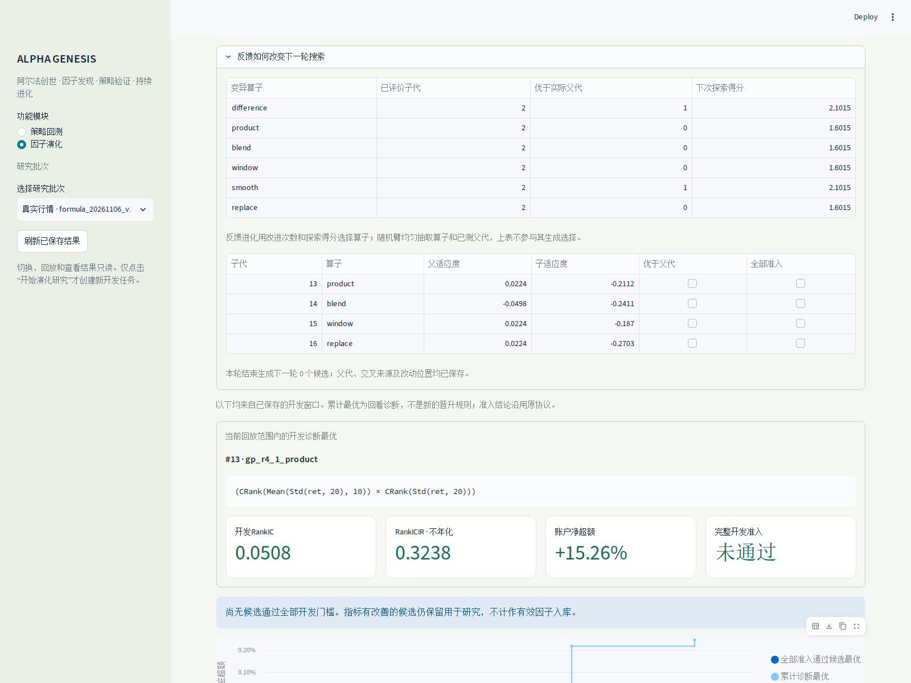
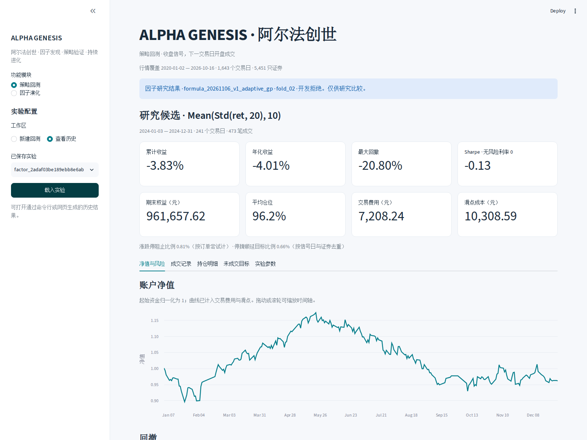

## 第六讲作业｜ALPHA GENESIS · 阿尔法创世：原系统内的公式自动挖掘

[代码、复现说明与四张实际运行界面](https://github.com/QiyuZhang-new/pku_quantllm/blob/main/lesson06/README.md) · [完整实验报告](https://github.com/QiyuZhang-new/pku_quantllm/blob/main/docs/AUTOMATIC_FACTOR_MINING.md) · [全部候选CSV](https://github.com/QiyuZhang-new/pku_quantllm/blob/main/docs/experiments/formula_20261106_v1/candidates.csv)

延续第四讲策略回测与第五讲因子评价，在**同一工作台**内加入“因子演化”：固定种子 → 公式组合/交叉变异 → 因果性检查 → 两个开发窗口的统计与账户验证 → 根据反馈选父、更新变异算子 → 继续搜索 → 冻结。没有另外做一个独立网页。

**实际设置：**固定120只证券（工程实例，非全市场）、100万元、5日调仓；每臂4轮×4候选，共32次候选评价和128次策略/等权基准账户回测。两开发窗口分别截至2023与2024年末，保留T+1、整手、历史ST/停牌/涨跌停、交易费用及参与率约束。起点包括Alpha#33、Alpha#101、5日价格变化、20日波动率；Alpha101目前核验接入8/101个公式。

| 方法 | 初始最佳研究适应度 | 最终最佳研究适应度 | 完整开发准入通过 |
| --- | ---: | ---: | ---: |
| 反馈公式进化 | −0.098663 | 0.022443 | 0/16 |
| 同预算随机公式对照 | −0.098663 | 0.008867 | 0/16 |

**一个自动挖掘实例：**系统将`Std(ret,20)`变异为`Mean(Std(ret,20),10)`。两个开发窗口的扣费账户收益由−10.01% / −12.08%改善至−4.38% / −3.83%。实际选父轨迹为#2→#8→#8→#8。还生成并实测了`CRank(Alpha#33) − CRank(Alpha#101)`等结构候选，父代、交叉来源、失败理由和逐轮反馈全部保留。

**运行界面截图（实际浏览器截取）：**

演化驾驶舱：4轮16个候选、实际研究父代与搜索轨迹。

候选#8的第二开发窗口：净收益−3.83%，相对同池等权账户超额+16.25个百分点；二者口径分开显示。

展开：反馈如何更新搜索，以及同一候选进入原策略回测历史

**验证与边界：**45项研究测试、27项界面/任务/原系统集成测试通过；另核对846个封存文件、128个账户、107,919条成交记录。当前为公式遗传搜索＋UCB反馈选算子，**在线LLM调用为0**。研究适应度不是收益率；最优候选仍亏损，所有候选均未通过全部准入，未认定有效alpha或启用交易。本次未打开2025—2026历史审核；120列、单个随机种子的结果不能证明机制普遍更优，也不称为新盲测。
