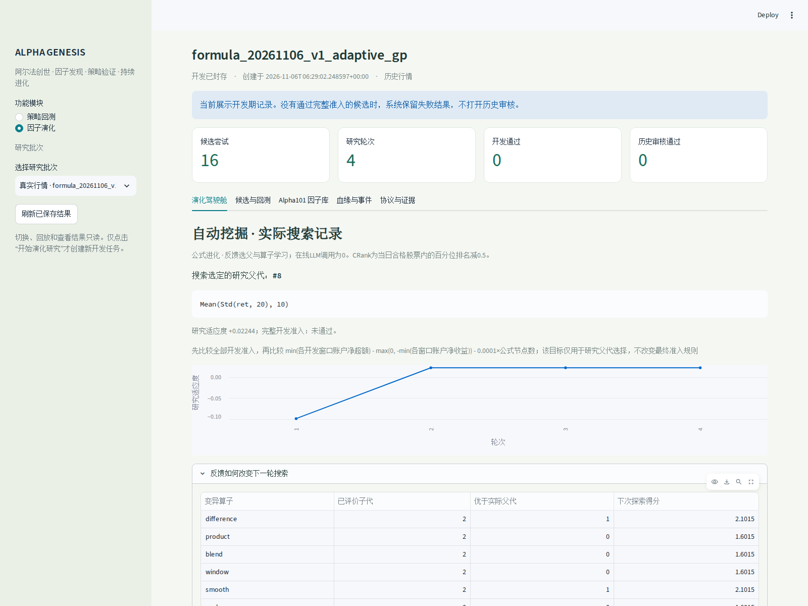
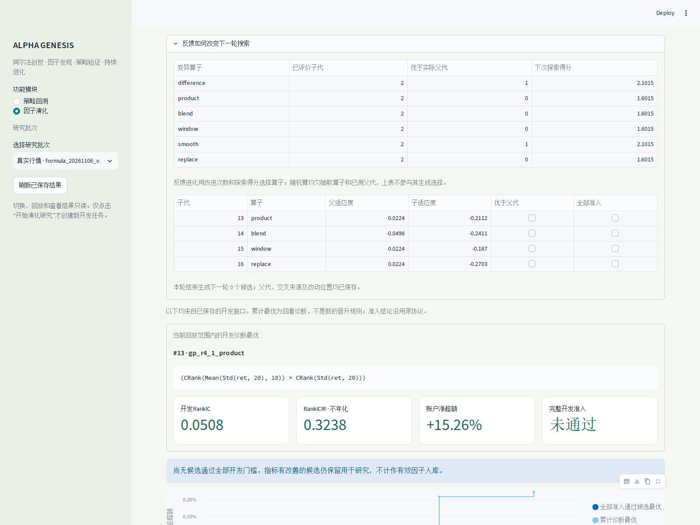
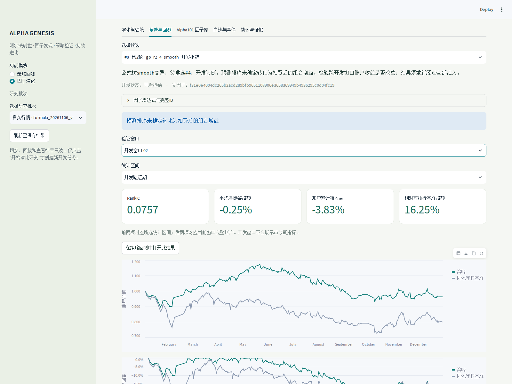
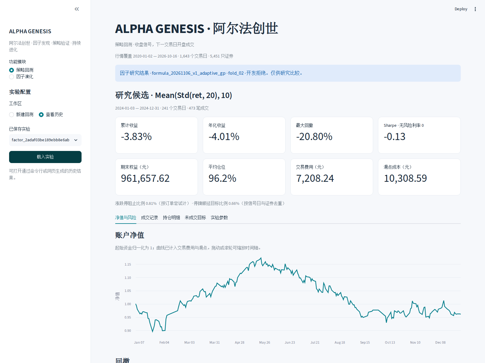
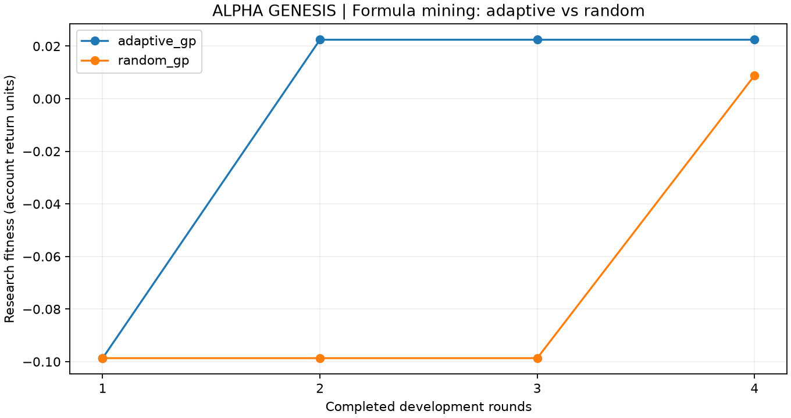

# 第六讲作业｜ALPHA GENESIS · 阿尔法创世

**把因子挖掘接入原量化交易系统：公式自动生成 → 统一评价与账户回测 → 反馈迭代 → 冻结与沉淀。**

本次在第四讲的策略回测工作台内增加“因子演化”模块，复用第五讲评价器和第四讲账户引擎，完成了真实行情的自动挖掘实例，并运行同预算随机对照。运行界面、结果和实现说明如下。

**结果边界：系统已跑通自动挖掘，但本次没有候选通过全部开发准入。** 当前使用有界公式树遗传搜索和反馈驱动的UCB算子选择；在线LLM调用为0，不涉及模型权重训练，不把这个原型称作完整RSI。

## 1. 运行界面可视化

以下四张图均由浏览器直接访问实际运行的`lesson04/app.py`截取，显示同一批次`formula_20261106_v1_adaptive_gp`，不是效果图。截图时间为2026-11-06；账户区间为2024年的开发验证窗口。两组对照曲线另由保存的实测结果绘制，见后文。

### 演化驾驶舱：实际父代与逐轮搜索轨迹

侧栏在同一工作台切换“策略回测 / 因子演化”。本批次完成4轮、16次候选评价，完整准入通过数为0；搜索选定的研究父代为#8，适应度曲线由真实账户反馈产生。



### 反馈迭代：算子如何得到改进记录

系统记录每个算子已经评价的子代数、优于实际父代的次数，以及下一轮探索得分。下表同时保留第四轮四个失败子代；“改善研究目标”和“通过全部准入”分开记录。



界面下方还有另一张按末窗口净标签超额排序的“开发诊断最优”卡，截图中为#13。该诊断与搜索使用的跨窗口账户适应度口径不同，不能把#13误当作实际选父结果#8。

### 候选账户：预测指标、净收益和可执行基准

选择候选#8、开发窗口02，可以同时看到RankIC、净标签超额、账户收益和相对同池等权账户的超额。**净收益−3.83%，相对基准超额+16.25个百分点；跑赢下跌基准仍不等于盈利。**



### 回到原系统：原生回测历史与费用展示

点击“在策略回测中打开此结果”，直接进入原有的回测结果页，并可以从“查看历史”重新加载。保留来源和“开发拒绝、仅供研究比较”的标记，支持原来的净值、回撤、成交、持仓与结果导出。



页头“5451只证券”指本机可用的完整行情面板；**本次挖掘实际固定使用120列**，并未运行全市场实验。

## 2. 自动挖掘实现

初始因子固定为Alpha#33、Alpha#101、5日价格变化和20日波动率。每轮先登记完整候选批次，再计算因子，做前缀一致性及未来数据扰动检查，进入固定的两个开发窗口，运行统计评价与策略/基准账户。

反馈组在已测候选中按适应度选前三名作为父代来源，自动尝试六类变异：居中截面秩之差、秩之积、秩组合、窗口变异、平滑和叶节点替换。公式最多15个节点、深度4；仅接受有界JSON表达式，不执行候选提供的任意Python。

研究选父先比较是否通过全部开发准入，再比较以下目标：

```text
fitness = min(各开发窗口账户净超额)
          − max(0, −min(各开发窗口账户净收益))
          − 0.0001 × 公式节点数
```

子代优于其实际父代时，相应算子增加一次改进记录；UCB在已有改进和未充分探索的算子之间分配后续搜索。每轮保留当时可见的反馈、实际父代、交叉来源和改动位置。早期回放不读取后续反馈。

随机对照使用相同的公式语法和评价预算，但均匀抽取已测父代与变异算子，不按反馈选择。两臂的四个共同初始因子均重新评价，不将其重复评价算作新发现。

最终准入不随搜索结果放宽：必须通过全部开发窗口的统计与账户门槛，再经相关性去重才能冻结为历史审核候选。通过研究选父条件不等于进入有效因子库。

## 3. 真实行情实例

| 项目 | 设置 |
| --- | --- |
| 股票样本 | 从课程5451列按固定等距位置取120列；不根据收益选股 |
| 开发矩阵 | 1212个交易日×120列 |
| 开发窗口1 | 训练截至2022-12-30，验证截至2023-12-29 |
| 开发窗口2 | 训练截至2023-12-29，验证截至2024-12-31 |
| 预算 | 每臂4轮×4候选；共32次候选评价、128次策略及基准账户回测 |
| 资金与成交 | 100万元；收盘信号，次日开盘成交，5日调仓 |
| 成本与约束 | 佣金万一、滑点5bp、卖出税万五；T+1、整手、历史ST/停牌/涨跌停与5%参与率约束 |
| 随机种子 | 20261106 |
| 后续历史 | 本次未打开2025—2026历史审核；已看过的历史不称为新盲测 |

| 方法 | 初始最佳适应度 | 最终最佳适应度 | 子代优于实际父代 | 完整准入通过 |
| --- | ---: | ---: | ---: | ---: |
| 反馈公式进化 | −0.098663 | 0.022443 | 2/12 | 0/16 |
| 随机公式对照 | −0.098663 | 0.008867 | 8/12 | 0/16 |



适应度是开发选父目标，不是收益率或样本外绩效。本次反馈组最终目标较高，但只运行了一个随机种子，不能证明其普遍优于随机搜索。随机组的父代可能更弱，所以“优于父代次数更多”也不能直接解释为收益更高。

实际选父轨迹为**#2 → #8 → #8 → #8**。#8是系统第二轮从#4自动变异得到的：

```text
父因子：Std(ret, 20)
子因子：Mean(Std(ret, 20), 10)
```

| 版本 | 2023开发账户净收益 | 2024开发账户净收益 |
| --- | ---: | ---: |
| 父因子#4：20日波动率 | −10.01% | −12.08% |
| 子因子#8：20日波动率的10日均值 | −4.38% | −3.83% |

另一个真实生成的结构变异是#5：`CRank(Alpha#33) − CRank(Alpha#101)`。它相对实际父代改善了研究目标，但两段账户收益仍为负，被保留为失败记录。

本次验证了自动挖掘与反馈闭环，尚未找到可认定有效的因子。跨期稳定性、显著性、净标签超额等仍有失败项；行业/规模中性化、完整退市覆盖、真实市场冲击和前瞻模拟交易尚未完成。

## 4. 代码、证据与复现

- [完整实验分析](../docs/AUTOMATIC_FACTOR_MINING.md)
- [全部候选及两个开发窗口CSV](../docs/experiments/formula_20261106_v1/candidates.csv)
- [机器可读结果](../docs/experiments/formula_20261106_v1/comparison.json) · [逐轮轨迹](../docs/experiments/formula_20261106_v1/history.csv)
- [账户与血缘核对结果](../docs/experiments/formula_20261106_v1/verification.json)
- [公式搜索](../quant_research/formula_search.py) · [研究管线](../quant_research/pipeline.py) · [固定预算双臂实验](../quant_research/experiment.py)
- [统一主界面](../lesson04/app.py) · [研究页面组件](../research_ui/workspace.py)

公开资料包含代码、说明、聚合结果和截图；原始行情、逐证券状态缓存、候选分数矩阵、本机环境与凭据不在本次提交中。截图来自本机完整研究记录；新检出不会自带这些完整账户缓存。

在仓库根目录安装第四讲已有依赖后，启动同一个工作台：

```bash
# 已有lesson04/.venv时直接使用；首次安装可运行 uv sync --project lesson04
lesson04/.venv/bin/python -m streamlit run lesson04/app.py \
  --server.address 127.0.0.1 --server.port 8501 --server.headless true \
  --browser.gatherUsageStats false
```

没有课程行情时，可在界面新建“合成流程对照”，验证自动搜索；合成结果不作为市场有效性证据。真实行情请按[第四讲数据说明](../lesson04/REQUIREMENTS.md)准备，并使用已有历史ST/交易状态缓存。之后运行：

```bash
PYTHONDONTWRITEBYTECODE=1 MPLCONFIGDIR=/tmp/quantllm-mpl \
lesson04/.venv/bin/python -m quant_research.experiment \
  --name my_formula_example --scope 120 --rounds 4 --seed 20261106
```

每次名称必须全新，已有研究不会覆盖。命令只运行开发搜索，不自动执行历史审核。

```bash
PYTHONDONTWRITEBYTECODE=1 MPLCONFIGDIR=/tmp/quantllm-mpl \
lesson04/.venv/bin/python -m unittest discover -s tests/research -v
PYTHONDONTWRITEBYTECODE=1 MPLCONFIGDIR=/tmp/quantllm-mpl \
lesson04/.venv/bin/python -m unittest discover -s tests/research_ui -v
```

本次45项研究测试和27项界面/任务/原系统集成测试通过。另核对846个封存文件、128个账户与107,919条成交记录，包括账户收益、费用和滑点合计、信号先于成交、父代先于子代，以及两臂输入与协议一致性。

## 5. 参考

参考[老师issue #10下的同学作业](https://github.com/aslan9/pku_quantllm/issues/10)，尤其是[公式级进化与同预算随机对照](https://github.com/Mai-Xu/Class_6-evolve/blob/main/reports/formula/v2/report.md)、[穿石的反馈记录与原系统集成](https://github.com/Chuboxiao/stoneflow-quant/blob/main/README_EVOLUTION.md)和[Factor Harness实测轨迹](https://github.com/libichong/tradingclass04/blob/main/FACTOR-HARNESS-EXPERIMENT.md)。本次数据与图表均为自行运行产生。
